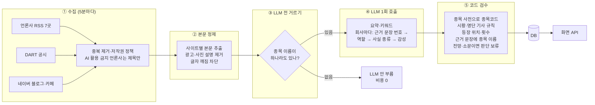
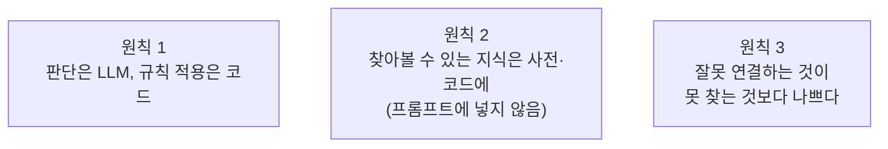
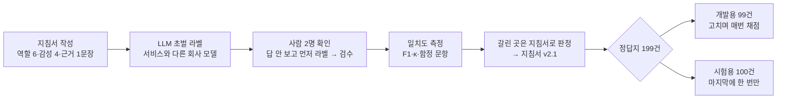
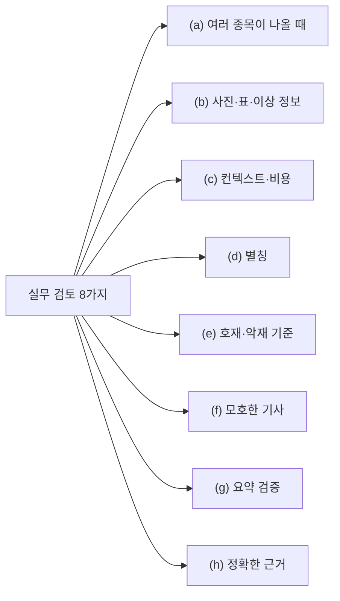
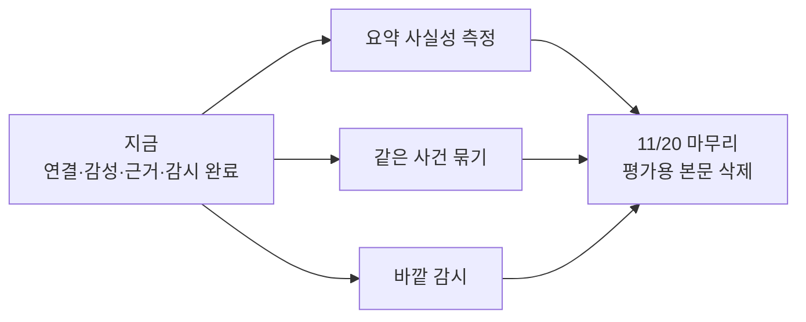

# AI 파트 설계 근거와 개발 계획

> 문서 종류: 설계 근거서 (실무 산출물) · 범위: 뉴스·공시·SNS → 종목 연결, 글 요약, 종목별 감성, 근거 문장
> 기준일: 2026-11-08 · 작성: 김태경 (AI 파트 보완 담당, 지승현님과 합의)
> 이 문서의 숫자는 모두 실측값이다. 각주는 근거 문헌·표준이고, 원문 링크는 맨 끝 [참고문헌](#참고문헌)에 있다.

---

## 목차

1. [한눈에 보기 — AI 파트는 이렇게 동작한다](#1-한눈에-보기--ai-파트는-이렇게-동작한다)
2. [설계 원칙 세 가지](#2-설계-원칙-세-가지)
3. [품질을 어떻게 재는가 — 평가 체계](#3-품질을-어떻게-재는가--평가-체계)
4. [요소별 근거와 방법 (실무 검토 8가지)](#4-요소별-근거와-방법-실무-검토-8가지)
5. [운영 안정성](#5-운영-안정성)
6. [개발 계획](#6-개발-계획)
7. [참고문헌](#참고문헌)

---

## 1. 한눈에 보기 — AI 파트는 이렇게 동작한다

기사 하나가 들어와서 화면에 "이 종목 · 주인공 · 호재 · 근거 문장"으로 나가기까지의 길이다. **LLM은 가운데에서 한 번만** 부르고, 앞뒤는 비용이 들지 않는 코드가 맡는다.

| 단계 | 하는 일 | 왜 이렇게 | 비용 |
|---|---|---|---|
| ① 수집 | RSS·공시·SNS를 5분마다 모음. 기사 끝에 "AI 학습 및 활용 금지"가 있는 언론사(연합뉴스·서울경제·연합인포맥스)는 본문을 받지 않고 제목만으로 종목을 찾음 | 언론사 약관과 robots.txt 준수[^robots] | 0 |
| ② 본문 정제 | 사이트별 규칙으로 본문만 꺼내고 광고·"관련종목" 꼬리표·깨진 글자를 걸러 냄 | 본문 외 잡음(보일러플레이트) 제거[^boilerpipe] | 0 |
| ③ LLM 전 거르기 | 제목·본문에 종목 사전의 이름이 하나도 없는 기사는 LLM을 부르지 않음 | 싼 단계에서 먼저 거르는 캐스케이드[^frugal] | 0 |
| ④ LLM 1회 | 요약·키워드와 함께, 회사마다 **근거 문장 번호를 먼저 고르고** 그 문장을 보고 역할·사실 종류·감성을 정함. 정해진 형식(JSON)으로만 답함 | 답보다 근거를 먼저[^cot], 형식 고정[^structured] | 기사당 약 1.5원[^price] |
| ⑤ 코드 검수 | LLM이 적은 회사 이름을 종목 사전에서 종목코드로 바꾸고, 기사 형태 규칙과 근거를 검사 | 판단은 LLM, 규칙 적용은 코드 (2절) | 0 |

---

## 2. 설계 원칙 세 가지

1. **판단은 LLM, 규칙 적용은 코드.** LLM은 "이 문장은 전망이다", "이 회사는 주인공이다" 같은 **문맥 판단**을 잘한다. 반대로 "전망이면 감성은 판단 보류" 같은 **규칙을 매번 똑같이 적용하는 일**은 자주 빠뜨린다. 그래서 LLM에게는 분류만 맡기고, 규칙은 코드가 매번 같은 방식으로 적용한다.
2. **찾아볼 수 있는 지식은 사전·코드에.** 종목 2,655개·별칭 516개·테마는 DB 사전에 두고 LLM 다음 단계의 코드가 쓴다. 프롬프트에 넣으면 호출마다 약 30,700토큰(지금 입력의 약 11배)이 붙는다. 사전을 늘려도 LLM 비용은 그대로다.
3. **잘못 연결하는 것이 못 찾는 것보다 나쁘다.** 투자자에게 엉뚱한 종목을 보여 주는 것이 하나를 빠뜨리는 것보다 해롭다. 그래서 애매한 별칭(예: "한미")은 검색에만 쓰고 연결에는 쓰지 않으며, 애매한 역할은 "나열"(연결 안 함)로 둔다.

---

## 3. 품질을 어떻게 재는가 — 평가 체계

"맞는지 어떻게 아느냐"에 답하려고, 고치기 전에 **채점 기준과 정답지**부터 만들었다. 데이터 라벨링 분야의 표준 주기 MATTER[^matter]를 따른다.

| 설계 | 한 것 | 근거 |
|---|---|---|
| 지침서 먼저 | 라벨 기준 v2.1 ([평가/라벨_기준_v2.md](평가/라벨_기준_v2.md)) | MATTER[^matter] |
| LLM 초벌 + 사람 확인 | 초벌은 LLM, 확인은 사람 2명 | LLM-사람 협업 라벨링[^wang] |
| 초벌 모델 ≠ 서비스 모델 | 초벌은 Claude, 서비스는 OpenAI | LLM은 자기가 만든 글을 더 좋게 평가한다[^panick] |
| 답을 안 보고 먼저 라벨 | 사람은 20건을 답 없이 먼저 라벨한 뒤 검수 | 미리 붙은 답이 사람 판단을 끌어당긴다[^fort] |
| 일치도 | **사람끼리 연결 F1 95.7%**, 역할 κ 0.61("상당한 일치"), 검수 동의 98.3%, 함정 문항 5개 중 4개 적발 | F1 일치도[^hripcsak], κ[^cohen]·해석[^landis], 함정 문항[^oleson] |
| 개발용 / 시험용 분리 | 시험용 100건은 절차를 먼저 적고(사전 등록), 개선이 끝난 뒤 한 번만 채점 | 모델 선택 과적합·정보 누수 방지[^cawley][^kaufman] |
| 불확실성 표시 | 모든 비율에 Wilson 95% 구간, 같은 기사 전후 비교는 McNemar 검정 | [^wilson][^mcnemar] |
| 회귀 시험 | 프롬프트·규칙·모델을 바꾸기 전에 개발용 99건으로 다시 채점, 기준 아래면 실패 (`python -m eval.regress`) | ML Test Score[^breck] |

**시험용 100건 결과 (한 번도 열지 않은 기사로 한 번 채점)**

| | 종목 연결 정확도 (Precision) | F1 | 여러 종목 기사 정확도 | 감성 일치 |
|---|---|---|---|---|
| 고치기 전 | 82.5% | 84.6 | — | 54.5% |
| **고친 뒤** | **95.9%** | **88.1** | **87.8%** | **61.3%** |

---

## 4. 요소별 근거와 방법 (실무 검토 8가지)

각 요소는 **질문 → 근거·표준 → 방법 → 결과 → 다음**의 순서로 적는다.

### (a) 한 글에 여러 종목이 나올 때, 진짜 연관인지 어떻게 가리나

- **근거·표준:** 개체 연결(entity linking)은 "이름 사전으로 후보 찾기 → 문맥으로 판단"의 두 단계가 표준 구조다[^shen]. 업계 뉴스 분석도 회사마다 "그 기사에서 얼마나 중심인가"를 따로 매긴다(RavenPack의 relevance)[^ravenpack].
- **방법:**
  1. LLM이 회사마다 역할을 6가지 중 하나로 고른다 — **주인공·당사자·비교**만 연결하고, **나열·출처·그룹**은 연결하지 않는다. (시황 등락 목록, 행사 참가사, 리포트를 낸 증권사 등은 "나열·출처")
  2. 코드가 기사 형태를 검사한다 — 시황 기사는 "제목에 나오고 그 종목만의 문장이 있을 때"만, 종목이 지나치게 많은 명단 기사는 연결 안 함, 제목·앞부분에 나오거나 본문에 2번 이상 나와야 연결.
  3. 이름은 최장 일치로 센다 — "SK하이닉스" 안의 "SK"를 따로 세지 않는다.
- **결과:** 여러 종목 기사의 연결 정확도 개발용 57.9% → 81.0%, **시험용 87.8%**.

### (b) 사진·표·이상한 정보 때문에 생기는 오차, 표를 빼서 생기는 오차

- **근거·표준:** 고치기 전에 문제의 크기를 먼저 잰다. 본문 외 잡음은 제거하는 것이 표준 처리다[^boilerpipe]. 비싼 처리(이미지 글자 인식 등)는 필요할 때만 쓰는 캐스케이드 원칙[^frugal].
- **방법과 측정:**

| 걱정 | 잰 것 | 결과 | 조치 |
|---|---|---|---|
| 표를 빼면 숫자를 놓친다 | 원문 299건의 페이지 전체 HTML 표 | **0개** (언론사들이 표를 이미지로 넣음) | 추출 방식 유지. 표를 버릴 때마다 개수를 세어 로그 → 표를 쓰는 사이트가 생기면 바로 보임 |
| 제목의 핵심 숫자가 본문에 없다 | 제목 숫자 48개 | 77%가 본문에 글자 그대로, 나머지도 표기만 다름 ("1.5조" ↔ "1조4575억원") | — |
| 이미지 속 정보 | 정보 그래픽이 있는 기사 | 7%. 실적 그래픽 기사도 본문에 숫자 있는 실적 문장 11~27개 → **이미지 때문에 생긴 연결 오류 0** | — |
| 깨진 글자·광고 | 파이낸셜뉴스 본문 글자 깨짐 | 232건 중 144건이 깨진 채 LLM에 들어가던 것을 찾아 수정·재처리 | 깨진 본문은 저장 전에 막고 개수를 셈. "관련종목" 꼬리표 줄은 매칭에서 제외 |

### (c) LLM 컨텍스트와 비용 — 회사에서 감당되나

- **근거·표준:** LLM 비용에는 "이 값이면 싸다"는 절대 기준이 없으므로, 일반적인 판단법 세 가지(대안 대비 총비용, 예산 대비, 같은 정확도의 다른 모델 대비[^frugal])로 잰다.

| 판단법 | 결과 |
|---|---|
| ① 대안 대비 총비용 | 한 달 9,000건 기준 사람 약 155만 원, 자체 GPU 약 103만 원, **우리 약 1.4만 원** → 74~110배 저렴 |
| ② 예산 대비 | 월 예산 5만 원의 약 28% |
| ③ 같은 정확도의 다른 모델 | 한 단계 비싼 모델(gpt-5.4-mini)을 같은 99건에 돌림 → **F1 같음(90.2 vs 90.2), 비용 2~3배** → 지금 모델이 합당 |

- **컨텍스트 근거:** 본문 앞 3,000자만 넣는다. 기사는 중요한 사실을 앞에 쓰는 역피라미드 구조이고[^pyramid], 요약 연구에서도 앞 세 문장(Lead-3)이 강한 기준선이다[^see]. 긴 입력의 가운데 정보는 모델이 놓치기 쉽다[^lost]. 실측: 본문 중앙값 1,035자, 정답 근거 문장 69개가 **모두** 앞 3,000자 안.
- **비용을 줄이는 구조:**
  - 종목·별칭 사전은 프롬프트 밖에 (2절 원칙 2)
  - 매번 같은 지시문(1,148토큰)은 프롬프트 캐시로 입력 단가의 1/10 ($0.20 → $0.02)[^cache][^price]
  - 종목과 이어질 수 없는 게 확실한 기사는 LLM을 부르지 않음 → 호출 −6.5%, 놓친 연결 0
  - 하루 비용 상한 설정(`LLM_DAILY_USD`)

### (d) 별칭

- **근거·표준:** 개체 연결의 첫 단계는 다양한 표기를 정식 이름으로 모아 주는 이름 사전이다[^shen].
- **방법:**
  - 별칭 516개를 종류 4가지로 관리 — 약칭(현대차), 예전 이름(기아차), 별명(삼전), **헷갈림**(한미 → 후보 4종목). 헷갈림은 검색에만 쓰고 자동 연결에는 쓰지 않는다 (원칙 3).
  - 표기 정규화: 공백·(주)·하이픈 제거, 괄호 이름("한국항공우주(KAI)"), 사업부 표기("한화 건설부문")를 처리.
  - **놓친 이름을 세서 보충:** LLM이 적었지만 사전에 없던 이름 2,022개를 나눠, 외국 회사·정부·비상장 자회사는 그대로 두고 **같은 법인의 사업부 이름**(롯데백화점·롯데마트 → 롯데쇼핑, 신세계백화점 → 신세계, GS25 → GS리테일, 이마트 트레이더스 → 이마트)을 추가.
- **결과:** 시험용 기사에서 놓치던 주인공 연결을 되찾아 재현율 86.8% → 94.7%.
- **다음:** 사전에 없는 이름 집계를 정기적으로 보고 보충.

### (e) 호재·악재 판단 기준

- **근거·표준:**
  - 정의: **"이 회사 주식을 지금 가진 주주에게, 기사에 적힌 사실이 다음 거래일까지 좋은 소식인가."** 투자자 관점의 정의는 금융 감성 데이터셋 Financial PhraseBank[^malo]와 같고, 종목마다 따로 매기는 것은 대상별 금융 감성 과제(SemEval-2017 Task 5[^semeval], FiQA 2018[^fiqa])의 정의다.
  - 기자의 형용사("훈풍", "먹구름")가 아니라 **사실**(실적·계약·수주·규제·소송)로 판단하고, 실적은 시장 전망치와의 비교를 우선한다.
- **세 갈래 검증:**

| 비교 대상 | 방법 | 결과 |
|---|---|---|
| 사람 정답 | 시험용 100건 | 54.5% → **61.3%** |
| 실제 주가 반응 | KIS 일봉으로 기사 당일 수익률(시장 평균 차감)을 감성별로 비교. 주가가 움직여서 쓴 기사(특징주 등)는 뺌 | 평균 반응 **호재 +0.83% > 중립 +0.08% > 악재 −0.75%** — 순서가 맞음 (이벤트 스터디 방식[^mackinlay], 뉴스와 주가의 관계 Tetlock 2007[^tetlock]) |
| 공개 전문가 라벨 | 한국어 금융 감성 데이터셋 KorFin-ASC[^korfin] 300문장 | 우리 기준으로 판단한 문장 **64~68% 일치** (무작위 33%), 호재↔악재 정반대 오류 300개 중 5개 |

- **쓰임새:** 감성은 "이 종목이 **왜** 움직였나를 설명하는 정보"로 제공한다. 다음 날 주가를 맞히는 예측 도구가 아니며, 화면에도 투자 조언이 아님을 표시한다.

### (f) 기자가 모호하게 쓰면 기준이 모호해진다

- **근거·표준:** 문장이 "일어난 일"인지 "전망·소문"인지 구분하는 것은 언어학의 사건 사실성(event factuality) 연구와 같은 구분이다(FactBank[^factbank]).
- **방법:**
  1. LLM이 근거 문장의 **사실 종류**를 고른다 — 일어난 일 / 회사 계획 / 전망·의견 / 소문("~알려졌다", "업계에 따르면").
  2. 근거가 **전망·소문뿐이면 감성은 "판단 보류"** — LLM이 아니라 코드가 항상 같은 방식으로 적용한다 (원칙 1).
  3. 유리한 사실과 불리한 사실이 비슷한 무게로 섞여도 판단 보류.
- **결과:** 감성 일치 58.5% → 65.1%, κ 0.43 → 0.53 (개발용). 모르는 것을 아는 척 단정하지 않는다.

### (g) 요약과 글을 한 번 더 검증

- **근거·표준:** 형식은 스키마로 고정한다[^structured]. 요약 모델은 기사에 없는 내용을 만들 수 있으므로[^maynez], 요약의 사실성은 요약을 작은 사실로 쪼개 원문과 대조하는 방식[^factscore]이나 문장 단위 일치 판정[^summac]으로 잰다.
- **지금 하는 검증:**

| 검증 | 방법 | 결과 |
|---|---|---|
| 형식 | 정해진 칸(JSON 스키마)으로만 답을 받음 | 813번 호출 형식 오류 0 |
| 내용 (코드) | 기사에 없는 연도를 쓴 답은 거부·재시도, 기사에 실제로 나온 회사만 남김, 근거 번호가 기사에 없으면 무시 | 자동 적용 |
| 입력 | 깨진 글자 본문은 LLM에 넣지 않음 (요약이 제목만 보고 지어내던 원인 제거) | 자동 적용 |
| 반복 안정성 | 같은 기사 3번 실행 | 연결 96% 같음 |
| 회귀 | 바꾸기 전에 정답지로 다시 채점 | 기준 아래면 반영 안 함 |

- **다음:** 요약문 사실성 표본 평가 — 요약을 짧은 사실 단위로 쪼개 기사와 하나씩 대조(FActScore 방식[^factscore])해 "기사에 없는 사실" 비율을 잰다. (6절 계획 1)

### (h) 정확한 근거

- **근거·표준:** 답보다 근거를 먼저 고르게 하면 판단이 근거에 묶인다[^cot]. 평가는 어느 쪽이 시스템 답인지 **가리고** 나란히 비교하는 방식[^wmt], 판정자는 서비스 모델과 다른 회사 모델로[^panick].
- **방법:**
  1. 본문 문장마다 번호를 붙여 LLM에 보내고, 회사마다 **근거 문장 번호를 먼저** 고르게 한다.
  2. 코드가 그 문장에 그 종목 이름이 실제로 있는지 확인한다. 화면에는 근거 문장 **하나만** 보이므로, 이름이 없으면 그 종목 이름이 있는 문장으로 바꾼다.
- **결과 (가린 판정):** 쓸 만한 근거 **78.4%**, **엉뚱한 근거 0개**. 같은 기준으로 판정한 사람(정답지) 근거는 84.3% — "가장 좋은 한 문장 고르기"는 사람도 갈리는 과제이고, 시스템이 그 수준에 가깝다.

---

## 5. 운영 안정성

| 항목 | 방법 | 근거 |
|---|---|---|
| 수집이 빠지면 | 실행마다 5가지 점검(수집 공백, 피드 연속 실패, 멈춘 기사, 수집량 급감, 글자 깨짐) → Slack 알림(새 문제·해결·12시간 계속). 지난 기록으로 돌려 보니 실제로 있었던 문제 3개를 모두 잡음 | 원인이 아니라 증상으로 경보, 신선도·오류 감시[^sre] |
| 모델이 바뀌면 | 날짜 고정 버전(`gpt-5.4-nano-2026-03-17`) 사용, 지원 종료일(2027-04-01) 확인 | 모델 스냅샷·지원 종료 정책[^deprec] |
| 고치다 예전 것이 깨지면 | 회귀 시험 — 기준(정확도 ≥ 0.90 등) 아래면 반영 안 함 | ML Test Score[^breck] |
| 기사가 10배 늘면 | 실행 1회 중앙값 71초, 기사당 요약 4~5.5초 → 10배여도 5분 주기 안 | 실측 |
| 기사 속 숨은 지시문 | 기사·지시문 구분자 분리, 출력 형식 고정, 출력 검증, LLM에 실행 권한 없음 | OWASP LLM01 Prompt Injection[^owasp] |
| 저작권 | AI 활용 금지 언론사는 제목만, robots.txt 준수, 본문은 7일 뒤 삭제·화면에 내보내지 않음 | RFC 9309[^robots] |
| 비밀값 | API 키·웹훅 주소는 `.env`에만, 커밋 금지 | 팀 규칙 |

---

## 6. 개발 계획

| # | 할 일 | 근거·표준 | 방법 | 완료 기준 |
|---|---|---|---|---|
| 1 | **요약 사실성 측정** (g) | 요약의 비사실 문제[^maynez], 사실 단위 평가[^factscore], 문장 일치 판정[^summac] | 요약을 짧은 사실로 쪼개 기사 원문과 대조하는 표본 평가. 판정자는 서비스와 다른 회사 모델[^panick] | "기사에 없는 사실" 비율과 95% 구간 보고 |
| 2 | **같은 사건 묶기** | 첫 보도와 반복 보도를 구분하는 업계 방식(RavenPack Event Novelty)[^ravenpack] | 같은 사건 기사에 묶음 번호를 저장하고 화면에 "같은 소식 n건", 순위·감성 비율은 사건 단위로 | 묶음 정확도 표본 확인, 이슈 순위 중복 제거 |
| 3 | **바깥 감시** | 시스템 안쪽 감시와 바깥 감시를 함께 둔다[^sre] | 백엔드가 마지막 수집 시각을 보고, 수집기가 멈추면 알림 | 수집기를 끈 상태에서 알림 확인 |
| 4 | **사람 확인 확대** | LLM 라벨 + 사람 확인[^wang] | 근거 문장·새 별칭 연결 표본을 사람이 확인 | 사람-시스템 일치도 보고 |
| 5 | **감성-주가 검증 기간 확대** | 이벤트 스터디[^mackinlay] | 수집이 쌓이는 대로 같은 분석을 다시 | 기간을 늘린 결과 보고 |
| 6 | **11/20 마무리** | 저작권 | 평가용으로 남긴 기사 본문 삭제 | 삭제 확인 |

---

## 참고문헌

각주 번호를 누르면 이곳으로 온다. 모든 링크는 2026-11-08 에 직접 열어 서지(제목·저자·연도)를 확인했다. 링크는 학회·출판사·표준 기관·공식 문서의 원문 페이지(DOI 포함)다.

**평가 방법론**

[^matter]: Pustejovsky, J., & Stubbs, A. (2012). *Natural Language Annotation for Machine Learning: A Guide to Corpus-Building for Applications*. O'Reilly Media. — 지침서 작성·라벨·일치도·판정을 반복하는 MATTER 주기. https://www.oreilly.com/library/view/natural-language-annotation/9781449332693/
[^wang]: Wang, X., Kim, H., Rahman, S., Mitra, K., & Miao, Z. (2024). Human-LLM Collaborative Annotation Through Effective Verification of LLM Labels. *Proceedings of the CHI Conference on Human Factors in Computing Systems (CHI '24)*, 1–21. ACM. https://doi.org/10.1145/3613904.3641960
[^panick]: Panickssery, A., Bowman, S. R., & Feng, S. (2024). LLM Evaluators Recognize and Favor Their Own Generations. *Advances in Neural Information Processing Systems 37 (NeurIPS 2024)*, 68772–68802. https://doi.org/10.52202/079017-2197 (arXiv: https://arxiv.org/abs/2404.13076)
[^fort]: Fort, K., & Sagot, B. (2010). Influence of Pre-annotation on POS-tagged Corpus Development. *Proceedings of the Fourth Linguistic Annotation Workshop (LAW IV)*, 56–63. ACL. https://aclanthology.org/W10-1807/
[^hripcsak]: Hripcsak, G., & Rothschild, A. S. (2005). Agreement, the F-measure, and Reliability in Information Retrieval. *Journal of the American Medical Informatics Association*, 12(3), 296–298. https://doi.org/10.1197/jamia.M1733
[^cohen]: Cohen, J. (1960). A Coefficient of Agreement for Nominal Scales. *Educational and Psychological Measurement*, 20(1), 37–46. https://doi.org/10.1177/001316446002000104
[^landis]: Landis, J. R., & Koch, G. G. (1977). The Measurement of Observer Agreement for Categorical Data. *Biometrics*, 33(1), 159–174. — κ 0.61~0.80 을 "상당한 일치(substantial)"로 해석. https://doi.org/10.2307/2529310
[^oleson]: Oleson, D., Sorokin, A., Laughlin, G., Hester, V., Le, J., & Biewald, L. (2011). Programmatic Gold: Targeted and Scalable Quality Assurance in Crowdsourcing. *Human Computation: Papers from the 2011 AAAI Workshop (HCOMP 2011)*, AAAI Technical Report WS-11-11. https://dl.acm.org/doi/10.5555/2908698.2908706
[^cawley]: Cawley, G. C., & Talbot, N. L. C. (2010). On Over-fitting in Model Selection and Subsequent Selection Bias in Performance Evaluation. *Journal of Machine Learning Research*, 11(70), 2079–2107. https://jmlr.org/papers/v11/cawley10a.html
[^kaufman]: Kaufman, S., Rosset, S., Perlich, C., & Stitelman, O. (2012). Leakage in Data Mining: Formulation, Detection, and Avoidance. *ACM Transactions on Knowledge Discovery from Data*, 6(4), 1–21. https://doi.org/10.1145/2382577.2382579
[^wilson]: Wilson, E. B. (1927). Probable Inference, the Law of Succession, and Statistical Inference. *Journal of the American Statistical Association*, 22(158), 209–212. https://doi.org/10.1080/01621459.1927.10502953
[^mcnemar]: McNemar, Q. (1947). Note on the Sampling Error of the Difference Between Correlated Proportions or Percentages. *Psychometrika*, 12(2), 153–157. https://doi.org/10.1007/BF02295996
[^breck]: Breck, E., Cai, S., Nielsen, E., Salib, M., & Sculley, D. (2017). The ML Test Score: A Rubric for ML Production Readiness and Technical Debt Reduction. *2017 IEEE International Conference on Big Data*, 1123–1132. https://doi.org/10.1109/BigData.2017.8258038
[^wmt]: Callison-Burch, C., Fordyce, C., Koehn, P., Monz, C., & Schroeder, J. (2007). (Meta-) Evaluation of Machine Translation. *Proceedings of the Second Workshop on Statistical Machine Translation*, 136–158. ACL. — 시스템 이름을 가리고 나란히 비교하는 사람 평가. https://aclanthology.org/W07-0718/

**종목 연결·본문 처리**

[^shen]: Shen, W., Wang, J., & Han, J. (2015). Entity Linking with a Knowledge Base: Issues, Techniques, and Solutions. *IEEE Transactions on Knowledge and Data Engineering*, 27(2), 443–460. https://doi.org/10.1109/TKDE.2014.2327028
[^ravenpack]: RavenPack. (2011, December 14). *Understanding News Flow – Country Distribution and Seasonality*. — "Relevance is a score between 0-100 that indicates how strongly the company relate[s] to the underlying news story", "The Event Novelty Score … represents how 'new' or novel a news story is within a 24-hour time window … The first story reporting a categorized event … receives a score of 100." https://www.ravenpack.com/research/news-flow-country-distribution-and-seasonality
[^boilerpipe]: Kohlschütter, C., Fankhauser, P., & Nejdl, W. (2010). Boilerplate Detection using Shallow Text Features. *Proceedings of the Third ACM International Conference on Web Search and Data Mining (WSDM '10)*, 441–450. https://doi.org/10.1145/1718487.1718542

**LLM 사용·비용·컨텍스트**

[^frugal]: Chen, L., Zaharia, M., & Zou, J. (2023). FrugalGPT: How to Use Large Language Models While Reducing Cost and Improving Performance. arXiv:2305.05176. https://arxiv.org/abs/2305.05176
[^pyramid]: Pöttker, H. (2003). News and its Communicative Quality: The Inverted Pyramid — When and Why Did It Appear? *Journalism Studies*, 4(4), 501–511. https://doi.org/10.1080/1461670032000136596
[^see]: See, A., Liu, P. J., & Manning, C. D. (2017). Get To The Point: Summarization with Pointer-Generator Networks. *Proceedings of the 55th Annual Meeting of the ACL*, 1073–1083. — Lead-3 기준선. https://aclanthology.org/P17-1099/
[^lost]: Liu, N. F., Lin, K., Hewitt, J., Paranjape, A., Bevilacqua, M., Petroni, F., & Liang, P. (2024). Lost in the Middle: How Language Models Use Long Contexts. *Transactions of the Association for Computational Linguistics*, 12, 157–173. https://aclanthology.org/2024.tacl-1.9/
[^cot]: Wei, J., Wang, X., Schuurmans, D., Bosma, M., Ichter, B., Xia, F., Chi, E., Le, Q., & Zhou, D. (2022). Chain-of-Thought Prompting Elicits Reasoning in Large Language Models. *NeurIPS 2022*. https://arxiv.org/abs/2201.11903
[^structured]: OpenAI. *Structured model outputs* (API 문서, 2026-11-08 확인). — "ensures the model will always generate responses that adhere to your supplied JSON Schema." https://developers.openai.com/api/docs/guides/structured-outputs
[^cache]: OpenAI. *Prompt caching* (API 문서, 2026-11-08 확인). — 다시 쓰는 앞부분 토큰은 캐시 입력 단가 적용, 지원 모델은 기본으로 켜짐. https://developers.openai.com/api/docs/guides/prompt-caching
[^price]: OpenAI. *Pricing* (API 문서, 2026-11-08 확인). — gpt-5.4-nano 100만 토큰당 입력 $0.20 · 캐시 입력 $0.02 · 출력 $1.25 (Standard). https://developers.openai.com/api/docs/pricing
[^deprec]: OpenAI. *Deprecations* (API 문서, 2026-11-08 확인). — `gpt-5.4-nano-2026-03-17` 지원 종료 2027-04-01, 대체 모델 안내 포함. https://developers.openai.com/api/docs/deprecations

**감성**

[^malo]: Malo, P., Sinha, A., Korhonen, P., Wallenius, J., & Takala, P. (2014). Good Debt or Bad Debt: Detecting Semantic Orientations in Economic Texts. *Journal of the Association for Information Science and Technology*, 65(4), 782–796. https://doi.org/10.1002/asi.23062 — 데이터셋 설명: "the annotators were asked to consider the sentences from the view point of an investor only" https://huggingface.co/datasets/takala/financial_phrasebank
[^semeval]: Cortis, K., Freitas, A., Daudert, T., Huerlimann, M., Zarrouk, M., Handschuh, S., & Davis, B. (2017). SemEval-2017 Task 5: Fine-Grained Sentiment Analysis on Financial Microblogs and News. *Proceedings of the 11th International Workshop on Semantic Evaluation (SemEval-2017)*, 519–535. https://aclanthology.org/S17-2089/
[^fiqa]: Maia, M., Handschuh, S., Freitas, A., Davis, B., McDermott, R., Zarrouk, M., & Balahur, A. (2018). WWW'18 Open Challenge: Financial Opinion Mining and Question Answering. *Companion Proceedings of The Web Conference 2018*, 1941–1942. https://doi.org/10.1145/3184558.3192301
[^korfin]: Son, G., Lee, H., Kang, N., & Hahm, M. (2023). Removing Non-Stationary Knowledge From Pre-Trained Language Models for Entity-Level Sentiment Classification in Finance. arXiv:2301.03136 (AAAI-23 Workshop Muffin). https://arxiv.org/abs/2301.03136 — 데이터셋 KorFin-ASC (CC BY-SA 4.0): https://huggingface.co/datasets/amphora/korfin-asc
[^mackinlay]: MacKinlay, A. C. (1997). Event Studies in Economics and Finance. *Journal of Economic Literature*, 35(1), 13–39. https://ideas.repec.org/a/aea/jeclit/v35y1997i1p13-39.html
[^tetlock]: Tetlock, P. C. (2007). Giving Content to Investor Sentiment: The Role of Media in the Stock Market. *The Journal of Finance*, 62(3), 1139–1168. https://doi.org/10.1111/j.1540-6261.2007.01232.x
[^factbank]: Saurí, R., & Pustejovsky, J. (2009). FactBank: A Corpus Annotated with Event Factuality. *Language Resources and Evaluation*, 43(3), 227–268. https://doi.org/10.1007/s10579-009-9089-9

**요약 사실성 (계획)**

[^maynez]: Maynez, J., Narayan, S., Bohnet, B., & McDonald, R. (2020). On Faithfulness and Factuality in Abstractive Summarization. *Proceedings of the 58th Annual Meeting of the ACL*, 1906–1919. https://aclanthology.org/2020.acl-main.173/
[^factscore]: Min, S., Krishna, K., Lyu, X., Lewis, M., Yih, W., Koh, P. W., Iyyer, M., Zettlemoyer, L., & Hajishirzi, H. (2023). FActScore: Fine-grained Atomic Evaluation of Factual Precision in Long Form Text Generation. *Proceedings of EMNLP 2023*, 12076–12100. https://aclanthology.org/2023.emnlp-main.741/
[^summac]: Laban, P., Schnabel, T., Bennett, P. N., & Hearst, M. A. (2022). SummaC: Re-Visiting NLI-based Models for Inconsistency Detection in Summarization. *Transactions of the Association for Computational Linguistics*, 10, 163–177. https://aclanthology.org/2022.tacl-1.10/

**운영·보안·저작권**

[^sre]: Ewaschuk, R. (2016). Monitoring Distributed Systems. In B. Beyer, C. Jones, J. Petoff, & N. R. Murphy (Eds.), *Site Reliability Engineering: How Google Runs Production Systems* (6장). O'Reilly. — 증상(무엇이 고장 났나)과 원인(왜)을 나눔, 바깥(black-box) 감시는 "symptom-oriented and represents active—not predicted—problems". https://sre.google/sre-book/monitoring-distributed-systems/
[^owasp]: OWASP GenAI Security Project. (2025). LLM01:2025 Prompt Injection. *OWASP Top 10 for LLM Applications 2025*. https://genai.owasp.org/llmrisk/llm01-prompt-injection/
[^robots]: Koster, M., Illyes, G., Zeller, H., & Sassman, L. (2022). *Robots Exclusion Protocol* (RFC 9309). IETF. https://www.rfc-editor.org/rfc/rfc9309
