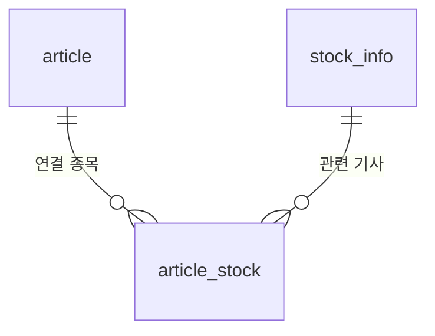

# AI 테이블 컬럼 제안 (AI → 백엔드)

`docs/db/schema.md` 의 "`article` 외 4개 — AI 파트와 컬럼 합의 후" 에 대한 AI 쪽 제안이다.
테이블 생성은 팀 규칙대로 **백엔드가 Flyway 로** 한다. 이 문서는 합의용 초안이고, 확정되면 `docs/db/schema.md` 로 옮긴다.

- 범위: **뉴스(RSS 실시간)만**. SNS·종합 요약 테이블은 해당 기능을 만들 때 따로 제안
- 형식: `docs/db/schema.md` 와 같은 열 순서, 같은 이름 규칙 (`uk_`, `idx_`, `fk_`, `ck_`)
- 시각은 모두 `DATETIME` (한국 시간)

## 테이블 목록

| 테이블 | 설명 | 쓰는 파트 | 읽는 파트 | schema.md 의 자리 |
|---|---|---|---|---|
| `article` | 뉴스 기사 + LLM 요약 | AI | 백엔드 | 뉴스·SNS 글, 분석 |
| `article_stock` | 기사-종목 연결 + 종목별 감성 | AI | 백엔드 | 매칭 결과 |
| `collect_run` | 수집·요약 실행 기록 (화면의 "갱신 시각") | AI | 백엔드 | 수집 기록 |

### article · 뉴스 기사

| # | Column Name | Data Type | Key | Not Null | Default | Comments |
|---|---|---|---|---|---|---|
| 1 | article_id | BIGINT | PK | Y | AUTO_INCREMENT | 기사 ID |
| 2 | url_key | VARCHAR(500) | UK | Y | | 추적용 꼬리(`utm_*`, `ref`, `input`)를 뗀 주소. 중복 판단용 |
| 3 | url | VARCHAR(1000) | | Y | | 원래 주소. 화면의 원문 링크 |
| 4 | press | VARCHAR(100) | | Y | | 언론사 이름 (모르는 곳은 도메인) |
| 5 | title | VARCHAR(500) | | Y | | 제목 |
| 6 | reporter | VARCHAR(100) | | N | | 기자명 |
| 7 | description | TEXT | | N | | RSS 짧은 요약문 |
| 8 | body | MEDIUMTEXT | | N | | 정제 본문. **7일 후 NULL 로 지움**, 백엔드는 조회하지 않음 |
| 9 | published_at | DATETIME | IDX | Y | | 발행 시각 (없으면 수집 시각) |
| 10 | collected_at | DATETIME | | Y | CURRENT_TIMESTAMP | 수집 시각 |
| 11 | status | VARCHAR(20) | CHECK, IDX | Y | 'LISTED' | 처리 상태 (아래) |
| 12 | retry_count | TINYINT | | Y | 0 | 실패 재시도 횟수 (3번 넘으면 FAILED) |
| 13 | last_error | VARCHAR(1000) | | N | | 마지막 오류 |
| 14 | summary | TEXT | | N | | LLM 요약. **계속 보관** |
| 15 | model | VARCHAR(50) | | N | | 요약한 모델 (AI 생성 표시용) |
| 16 | summarized_at | DATETIME | | N | | 요약 시각 |

- UK `uk_article_url_key (url_key)`: 같은 기사 두 번 저장 금지
- IDX `idx_article_status (status)`, `idx_article_published (published_at)`
- CHECK `ck_article_status`: `status IN ('LISTED','FETCHED','SUMMARIZED','DONE','FAILED','SKIPPED','NO_STOCK')`
- 처리 상태

  | 값 | 뜻 | 화면 노출 |
  |---|---|---|
  | LISTED | RSS 목록에서 받음 | |
  | FETCHED | 본문 가져옴 | |
  | SUMMARIZED | LLM 요약 끝 | |
  | **DONE** | 종목 연결까지 끝 | ✅ |
  | FAILED | 본문·요약 3번 실패 | |
  | SKIPPED | robots.txt 금지 등 수집 제외 | |
  | NO_STOCK | 요약했지만 연결된 코스피200 종목 없음 | |

- 버린 기사(FAILED·SKIPPED·NO_STOCK)도 **행은 지우지 않음**: 지우면 RSS 에 떠 있는 동안 다시 받아서 다시 요약함 (비용 낭비)

### article_stock · 기사-종목 연결

| # | Column Name | Data Type | Key | Not Null | Default | Comments |
|---|---|---|---|---|---|---|
| 1 | article_id | BIGINT | PK, FK → article (CASCADE) | Y | | 기사 ID |
| 2 | stock_code | CHAR(6) | PK, FK → stock_info, IDX | Y | | 종목코드 |
| 3 | is_main | BOOLEAN | | Y | FALSE | 대표 종목 여부 (기능정의서 '주된 종목 판별') |
| 4 | sentiment | VARCHAR(10) | CHECK | Y | | POSITIVE / NEGATIVE / NEUTRAL |
| 5 | reason | VARCHAR(500) | | Y | | 감성 판단 이유 |
| 6 | created_at | DATETIME | | Y | CURRENT_TIMESTAMP | 연결 시각 |

- PK `(article_id, stock_code)`, IDX `idx_article_stock_stock (stock_code)`: 종목별 기사 목록
- CHECK `ck_article_stock_sentiment`: `sentiment IN ('POSITIVE','NEGATIVE','NEUTRAL')`
- 매칭 점수(`match_setting` 의 종목명·테마·문맥 가중치) 컬럼은 **매칭 방식이 정해지면 추가** (AI 쪽 보류 중)

### collect_run · 수집 실행 기록

| # | Column Name | Data Type | Key | Not Null | Default | Comments |
|---|---|---|---|---|---|---|
| 1 | run_id | BIGINT | PK | Y | AUTO_INCREMENT | 실행 ID |
| 2 | started_at | DATETIME | | Y | | 시작 시각 |
| 3 | finished_at | DATETIME | IDX① | N | | 끝난 시각 (실행 중이면 NULL) |
| 4 | status | VARCHAR(10) | CHECK, IDX① | Y | 'RUNNING' | RUNNING / SUCCESS / FAILED |
| 5 | collected_count | INT | | Y | 0 | 새로 받은 기사 수 |
| 6 | summarized_count | INT | | Y | 0 | 요약한 기사 수 |
| 7 | error | TEXT | | N | | 실패 원인 |

- IDX① `idx_collect_run_status_finished (status, finished_at)`: "갱신 시각" = `status = 'SUCCESS'` 인 가장 최근 `finished_at`
- CHECK `ck_collect_run_status`

## 백엔드가 읽는 법 (제안)

- 화면 노출: `article.status = 'DONE'` 인 기사만. `body` 는 조회하지 않음 (언론사 정책: 원문 대체 금지)
- 종목 화면 뉴스 목록: `article_stock.stock_code = ?` → `article` 조인, `published_at` 최신순
- API 응답은 팀 약속대로 camelCase + `+09:00` 시각으로 변환 (백엔드 `TimeUtils.toKst()`)

## 확인이 필요한 것

| # | 질문 | AI 쪽 생각 |
|---|---|---|
| 1 | `article_stock.stock_code` 를 `stock_info` FK 로 걸까? | 걸고 싶음. 단 `stock_info` 에 코스피200 전체가 들어 있어야 함 (지금 V2 는 예시 5개) |
| 2 | 상태·감성 값을 대문자로 (`role` 처럼) | 대문자로 맞춤 |
| 3 | `0126Z0` 처럼 영문 섞인 종목코드 | `CHAR(6)` 그대로 들어감. 숫자 검사(CHECK)는 넣지 않기 |
| 4 | SNS·종합 요약 테이블 | 뉴스 끝난 뒤 따로 제안 |
