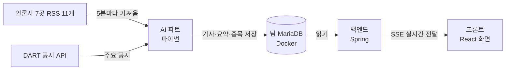
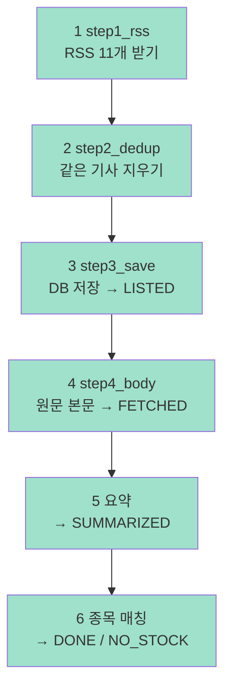

# 0. 전체 그림

## 한 줄 요약

**경제 뉴스를 5분마다 모아서 → 본문을 읽고 → LLM 으로 요약하고 → 어떤 종목 이야기인지 연결**해서 DB 에 넣는다. 화면은 백엔드가 그 DB 를 읽어서 보여준다.

## 팀 안에서 AI 파트의 위치



- AI 와 백엔드는 **서로 직접 부르지 않는다.** DB 테이블 형식만 약속하고, AI 는 쓰고 백엔드는 읽는다
- 그래서 AI 쪽에는 서버·웹소켓이 없다. **정해진 때마다 한 번 돌고 끝나는 프로그램(배치)**
- 실시간으로 화면에 밀어주는 것(SSE)은 백엔드 담당

## 왜 "5분마다 가져오기"인가 (폴링)

RSS 는 언론사 사이트에 올려진 **최신 기사 목록 파일**이다. 언론사가 우리에게 보내주지 않는다.
→ 우리가 주기적으로 가서 다시 읽고, **새로 생긴 것만** 골라야 한다. 이걸 **폴링(polling)** 이라고 한다.
"실시간" = "얼마나 자주 가서 확인하느냐". 지금은 5분 (결정사항). 기사 수는 그대로라 LLM 비용은 같고 RSS 요청만 늘어난다.

## 파이프라인: 기사 한 건이 지나가는 길


초록 = 완료 (2026-11-02 기준). 다음은 정확도 확인·튜닝.

## 단계를 잇는 방법: `status` 칸

DB `article` 테이블의 `status` 칸이 **"이 기사가 어디까지 처리됐나"** 표시다.
각 단계는 앞 단계를 직접 부르지 않고, **자기 차례인 상태의 기사만 골라서** 일한다.

| status | 뜻 | 다음에 누가 가져가나 |
|---|---|---|
| `LISTED` | 제목·링크만 있음 | 4단계 (본문) |
| `FETCHED` | 본문 있음 | 5단계 (요약) |
| `SUMMARIZED` | 요약 끝 | 6단계 (종목 매칭) |
| `DONE` | 종목 연결 끝 → **화면에 나옴** | 백엔드 |
| `NO_STOCK` | 연결할 종목 없음 → 화면에 안 나옴 | — |
| `SKIPPED` | 처리 안 하기로 함 (유료 기사, robots 금지 등) | — |
| `FAILED` | 3번 실패 | — |

좋은 점: 중간 단계가 실패해도 **그 단계만 다시 돌리면** 된다. 앞 단계를 다시 할 필요 없음.

## 폴더

```
ai/
├── hk_llm/              ← 코드 (파이썬 패키지)
│   ├── run.py           ★ 이것만 실행하면 1→6 단계가 순서대로 돎
│   ├── step1_rss.py ~ step6_match.py   단계별 파일 (번호 = 순서)
│   ├── models.py        기사 한 건의 모양 (Article)
│   ├── db.py            DB 연결
│   ├── util.py          로그·재시도
│   ├── config.py        설정 (.env 읽기, 시간대)
│   ├── robots.py        본문 가져오기 전 허용 확인
│   ├── tools/           가끔 손으로 돌리는 도구
│   ├── data/ logs/      (Git 에 안 올림)
├── docs/                ← 문서 (지금 보는 곳)
└── requirements.txt     ← 필요한 라이브러리 목록
```

## 실행하기

```bash
# 레포 최상위에서: DB 켜기 (Docker Desktop 이 켜져 있어야 함)
docker compose up -d db

# ai 폴더에서
.venv\Scripts\activate
python -m hk_llm.run          # ⚠️ 요약 단계에서 OpenAI 비용 발생 (1번에 최대 200건, 약 $0.13)
python -m hk_llm.run --check  # 비용 없이 1~3단계만 시험
```

## 용어

| 용어 | 뜻 |
|---|---|
| RSS | 사이트가 올려두는 "최신 글 목록" XML 파일 |
| 폴링 | 상대가 안 알려주니 내가 주기적으로 가서 확인하는 방식 |
| 배치 | 한 번 돌고 끝나는 프로그램. 이걸 주기적으로 실행 |
| 파이프라인 | 데이터가 여러 단계를 순서대로 통과하는 구조 |
| DB / MariaDB | 데이터를 표(테이블)로 저장하는 프로그램. 팀은 MariaDB 사용 |
| Docker | 프로그램(여기선 MariaDB)을 상자에 담아 누구 PC 에서나 똑같이 켜는 도구 |
| Flyway | 백엔드가 켜질 때 `V1, V2, …` SQL 파일을 순서대로 실행해 테이블을 만드는 도구 |
| `.env` | 비밀번호·API 키를 적는 파일. **Git 에 절대 안 올림** |
| SSE | 서버가 화면 쪽으로 새 소식을 밀어주는 방식 (백엔드 담당) |
| robots.txt | 사이트가 "봇은 여기까지만 가져가세요" 라고 적어둔 파일 |
| KST | 한국 시간 (UTC+9). 팀 약속: 모든 시간은 KST |

## 확인 질문

1. AI 파트에 서버가 없어도 되는 이유는?
2. 4단계(본문)가 오류로 멈췄다. 다시 돌릴 때 RSS 부터 다시 받아야 하나?
3. 화면에 나오는 기사는 어떤 `status` 인가?

<details><summary>▶ 답 보기</summary>

1. 백엔드가 AI 를 부르지 않고 DB 만 읽기 때문. AI 는 DB 에 쓰기만 하면 된다
2. 아니다. 4단계는 `LISTED` 기사만 골라서 하므로, 4단계만 다시 돌리면 멈춘 곳부터 이어서 한다
3. `DONE` (종목까지 연결된 기사)

</details>
