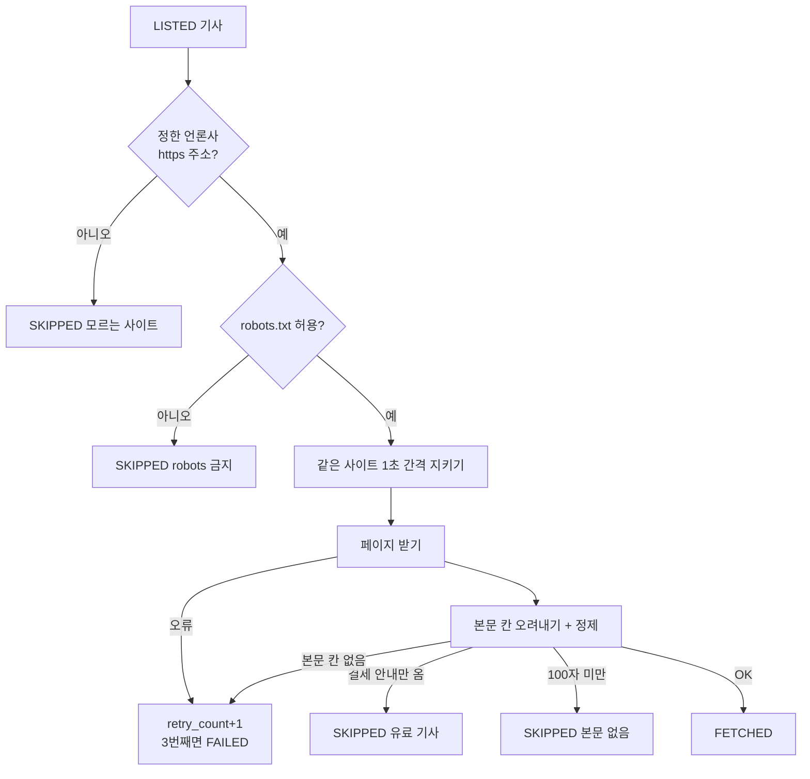

# 5. 4단계: 원문 본문 가져오기 (`step4_body.py`, 개발순서 20~22번)

## 한 줄 요약

`LISTED` 기사의 **원문 페이지에 가서 본문만 오려 내고**, 잡음을 지워 `body` 에 저장 → `FETCHED`. 본문은 7일 후 삭제.

## 왜 필요한가

LLM 이 요약하려면 본문이 있어야 한다. RSS 에는 제목뿐 (한경은 요약문도 없음).

## 들어가고 나오는 것

| | 내용 |
|---|---|
| 들어감 | DB 의 `status = 'LISTED'` 기사 (어제 이후, 새 기사부터 최대 200건) |
| 나옴 | `FETCHED` / `SKIPPED` / 다시 시도 / `FAILED` 건수 |
| DB | `body`, `status`, `retry_count`, `last_error` 업데이트 |

## 기사 1건 처리 순서



## 개념 1: robots.txt (`robots.py`)

사이트마다 `https://사이트/robots.txt` 에 "봇은 어디까지 가져가도 된다" 가 적혀 있다.
```
User-agent: *
Disallow: /print/        ← 이 경로는 가져가지 마세요
```
- `allowed(url)`: 우리 봇 이름(`hk-llm-news-bot`)으로 허용되는지 판단. 사이트마다 한 번만 받아서 기억
- **확인 못 하면 안 가져가는 쪽** (서버 오류 등). 파일이 아예 없으면(404) 제한 없음으로 봄 (표준 RFC 9309)
- 요청 간격: robots.txt 의 `Crawl-delay`, 없으면 **1초**. 최대 10초까지만 기다림

## 개념 2: HTML 에서 본문 칸 찾기 (XPath)

웹페이지(HTML)는 상자 안에 상자가 든 구조다. 본문이 든 상자를 **주소처럼** 가리키는 게 XPath.

```python
BODY_XPATH = {
    "www.hankyung.com": '//*[@id="articletxt"]',              # id 가 articletxt 인 상자
    "www.yna.co.kr":    '//div[contains(@class, "story-news")]/p',  # story-news 상자 안의 문단들
    "www.sedaily.com":  '//*[@id="article-body"]',
    "www.fnnews.com":   '//div[contains(@class, "article-view__body")]',
    "www.etnews.com":   '//*[@itemprop="articleBody"]',   # 연합인포맥스·비즈워치도 같은 표시
}
```
- 어떻게 찾았나: 기사 페이지를 받아서 **한글이 가장 많이 든 상자**를 찾아 이름 확인
- 처음엔 범용 추출기(`trafilatura`)를 시험 → 한경·연합에서 메뉴·사진 설명·공유 버튼이 섞임 → 언론사 수가 적어서 직접 지정이 더 정확
- 언론사가 사이트 디자인을 바꾸면 이 주소가 깨질 수 있다 → 그때 "본문 칸 못 찾음" 실패가 늘어나서 알 수 있음

## 개념 3: 정제 (`extract`, `clean`)

| 지우는 것 | 이유 |
|---|---|
| 사진·사진 설명 (`figure`), 광고 (`aside`), 표 (`table`) | 요약에 방해 |
| 기자 이메일 줄, `ⓒ`·`무단 전재` 저작권 줄, `제보는 …` | 내용 아님 |
| 연합 `2026/11/02 10:30 송고` | 시각 표시일 뿐 |
| 여러 칸 공백 | 한 칸으로 |

## 상태 규칙: 다시 시도할까, 포기할까

| 상황 | 결과 | 이유 |
|---|---|---|
| 네트워크 오류, 본문 칸 못 찾음 | `LISTED` 그대로 + `retry_count`+1 → 다음 실행에서 다시. 3번째면 `FAILED` | 일시적일 수 있음 |
| 페이지는 왔는데 본문 100자 미만 (`[속보]`, `[표]`) | `SKIPPED` | 다시 해도 같음 |
| 한경 유료 기사 (결제 안내만 옴) | `SKIPPED` | **우회하지 않음** (결정사항 7번) |
| robots 금지, 모르는 사이트 | `SKIPPED` | 규칙 |

## 7일 후 본문 삭제 (`purge_old_bodies`)

언론사들이 "AI 학습 및 활용 금지" 를 걸어 두었다 (연합·서경 기사 끝 문구). 그래서:
- 화면엔 **요약 + 원문 링크만** (본문 안 보여줌)
- 본문은 요약에만 쓰고 **7일 후 지움** (요약은 남김)
- `run.py` 가 매 실행마다 호출. 수집이 실패해도 삭제는 꼭 하도록 `finally` 안에 둠

## 실제 결과 (2026-11-02)

- 477건 중 `FETCHED` 421, `SKIPPED` 56 (한경 유료 37, 본문 없음 19), `FAILED` 0
- 본문 평균 1,000~1,600자
- 한경 기사의 36% 가 유료 → 화면에 안 나옴

## 직접 해보기

```bash
python -m tests                       # 가짜 HTML 정제, 한경 /print/ 금지 등 확인
python -m hk_llm.steps.step4_body     # 실제 언론사별 1건씩 → ok
```

## 확인 질문

1. `[속보]` 기사는 왜 3번 다시 시도하지 않고 바로 `SKIPPED` 인가?
2. 한경이 내일 디자인을 바꿔서 `articletxt` 가 없어지면 어떻게 되나?
3. 본문을 영구 보관하지 않는 이유는?

<details><summary>▶ 답 보기</summary>

1. 페이지는 정상으로 왔는데 본문이 원래 짧은 것. 다시 받아도 같으니 요청 낭비
2. 한경 기사가 전부 "본문 칸 못 찾음" → 3번 뒤 `FAILED`. 로그에 경고가 쌓이니 그걸 보고 `BODY_XPATH` 를 고친다
3. 언론사 정책(원문 대체·AI 학습 금지). 요약 만드는 데만 잠깐 쓰고 7일 후 지움

</details>
