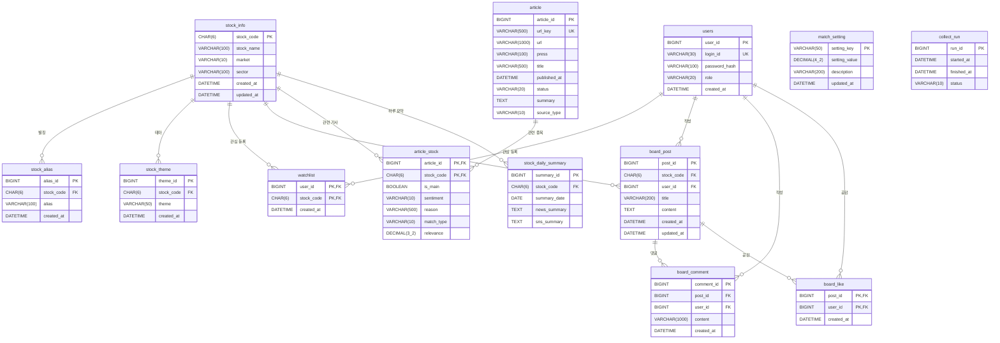

# DB 설계 (테이블 정의서 · ERD)

- DB: MariaDB 11.8.9, 문자셋 utf8mb4 / utf8mb4_unicode_ci, 시간대 +09:00
- 테이블 생성·변경은 백엔드가 Flyway로만 합니다. (`backend/src/main/resources/db/migration`)
- 이 문서는 Flyway SQL을 기준으로 씁니다. 테이블을 바꾸면 이 문서도 같은 PR에서 고칩니다.
- 제약 조건이 실제로 동작하는지는 [쿼리 테스트](query-test.md)에 기록합니다.

## 테이블 목록

| 테이블 | 설명 | 쓰는 파트 | 읽는 파트 | Flyway | 상태 |
|---|---|---|---|---|---|
| `stock_info` | 종목 기본 정보 | 백엔드 | AI, 백엔드 | V1 | ✅ |
| `stock_alias` | 종목 약칭·별칭 | 백엔드 | AI, 백엔드 | V3 | ✅ |
| `stock_theme` | 종목 테마 키워드 | 백엔드 | AI, 백엔드 | V3 | ✅ |
| `match_setting` | 매칭 가중치·최소 점수 | 백엔드 | AI | V3 | ✅ |
| `users` | 회원 | 백엔드 | 백엔드 | V4 | ✅ |
| `watchlist` | 관심 종목 | 백엔드 | 백엔드 | V4 | ✅ |
| `board_post` | 종목 토론 게시글 | 백엔드 | 백엔드 | V4 | ✅ |
| `board_comment` | 게시글 댓글 | 백엔드 | 백엔드 | V4 | ✅ |
| `board_like` | 게시글 공감 | 백엔드 | 백엔드 | V4 | ✅ |
| `article` | 뉴스·SNS 글 + LLM 요약 | AI | 백엔드 | V5 | ✅ |
| `article_stock` | 기사 × 종목 연결 (감성, 이유, 관련도) | AI | 백엔드 | V5 | ✅ |
| `collect_run` | 수집·요약 실행 기록 | AI | 백엔드 | V5 | ✅ |
| `stock_daily_summary` | 종목별 하루 종합 요약 | AI | 백엔드 | V5 | ✅ (AI가 나중에 채움) |

AI 테이블(V5)은 AI 파트 제안서(`ai/docs/AI테이블_제안.md`)를 그대로 바탕으로 하고, 요구사항에 있지만 아직 정해지지 않은 칸을 **[확장]**으로 덧붙였습니다. [확장] 칸은 비워 둘 수 있어서 AI 코드가 몰라도 저장되고, 쓰지 않게 되면 나중에 지웁니다.

## 설계 원칙

- **시각:** 모두 `DATETIME` (한국 시간). 문자열로 저장하지 않음
- **같은 의미의 키는 같은 타입:** 종목코드는 어디서나 `CHAR(6)`, 회원 ID는 어디서나 `BIGINT`
- **종목코드는 문자열:** `"005930"`처럼 앞자리 0 보존
- **모든 컬럼에 COMMENT:** DB만 봐도 뜻을 알 수 있게
- **잘못된 데이터는 DB에서도 막음:** UNIQUE(중복), FOREIGN KEY(없는 대상 참조), CHECK(허용 값·빈 문자열)
- **삭제 규칙:** 게시글에 딸린 댓글·공감은 게시글과 함께 삭제(`ON DELETE CASCADE`). 그 밖의 참조는 삭제를 막음(기본값 `RESTRICT`)
- **이름 규칙:** 기본키 `PK`, 유니크 `uk_테이블_컬럼`, 인덱스 `idx_테이블_컬럼`, 외래키 `fk_테이블_대상`, 체크 `ck_테이블_컬럼`

## ERD

GitHub에서는 아래 그림이 자동으로 그려집니다.

`match_setting`, `collect_run`은 다른 테이블과 연결되지 않는 표입니다. ERD의 AI 테이블은 주요 칸만 보였고, 전체 칸은 아래 테이블 정의서에 있습니다.

## 테이블 정의서

산출물(xlsx) 양식과 같은 열 순서입니다: Col # / Column Name / Data Type / Key / Not Null / Default / Comments

### stock_info · 종목 기본 정보 (V1)

| # | Column Name | Data Type | Key | Not Null | Default | Comments |
|---|---|---|---|---|---|---|
| 1 | stock_code | CHAR(6) | PK | Y | | 종목코드 6자리 (앞자리 0 보존) |
| 2 | stock_name | VARCHAR(100) | | Y | | 종목명 |
| 3 | market | VARCHAR(10) | | Y | | KOSPI, KOSDAQ |
| 4 | sector | VARCHAR(100) | | N | | 업종 |
| 5 | created_at | DATETIME | | Y | CURRENT_TIMESTAMP | 등록 시각 |
| 6 | updated_at | DATETIME | | Y | CURRENT_TIMESTAMP (수정 시 갱신) | 수정 시각 |

### stock_alias · 종목 약칭·별칭 (V3)

| # | Column Name | Data Type | Key | Not Null | Default | Comments |
|---|---|---|---|---|---|---|
| 1 | alias_id | BIGINT | PK | Y | AUTO_INCREMENT | 별칭 ID |
| 2 | stock_code | CHAR(6) | FK → stock_info, UK① | Y | | 종목코드 |
| 3 | alias | VARCHAR(100) | UK①, IDX | Y | | 약칭·별칭 (예: 삼전) |
| 4 | created_at | DATETIME | | Y | CURRENT_TIMESTAMP | 등록 시각 |

- UK① `uk_stock_alias (stock_code, alias)`: 같은 종목에 같은 별칭은 한 번만. 다른 종목에는 같은 별칭 가능
- IDX `idx_stock_alias_alias (alias)`: 별칭으로 종목 찾기

### stock_theme · 종목 테마 키워드 (V3)

| # | Column Name | Data Type | Key | Not Null | Default | Comments |
|---|---|---|---|---|---|---|
| 1 | theme_id | BIGINT | PK | Y | AUTO_INCREMENT | 테마 ID |
| 2 | stock_code | CHAR(6) | FK → stock_info, UK① | Y | | 종목코드 |
| 3 | theme | VARCHAR(50) | UK①, IDX | Y | | 테마 키워드 (예: 방산) |
| 4 | created_at | DATETIME | | Y | CURRENT_TIMESTAMP | 등록 시각 |

- UK① `uk_stock_theme (stock_code, theme)`, IDX `idx_stock_theme_theme (theme)`: 테마로 종목 찾기

### match_setting · 매칭 설정값 (V3)

| # | Column Name | Data Type | Key | Not Null | Default | Comments |
|---|---|---|---|---|---|---|
| 1 | setting_key | VARCHAR(50) | PK | Y | | 설정 이름 |
| 2 | setting_value | DECIMAL(4,2) | | Y | | 설정 값 (0.00~1.00) |
| 3 | description | VARCHAR(200) | | N | | 설명 |
| 4 | updated_at | DATETIME | | Y | CURRENT_TIMESTAMP (수정 시 갱신) | 수정 시각 |

초기값 (V3에서 입력, 요구사항 2026-10-29 기준):

| setting_key | setting_value | description |
|---|---|---|
| name_weight | 0.40 | 종목명 일치 가중치 |
| theme_weight | 0.40 | 테마 일치 가중치 |
| context_weight | 0.20 | 문맥(LLM 판단) 가중치 |
| min_score | 0.70 | 저장할 최소 관련도 |

### users · 회원 (V4)

| # | Column Name | Data Type | Key | Not Null | Default | Comments |
|---|---|---|---|---|---|---|
| 1 | user_id | BIGINT | PK | Y | AUTO_INCREMENT | 회원 ID |
| 2 | login_id | VARCHAR(30) | UK | Y | | 로그인 아이디 |
| 3 | password_hash | VARCHAR(100) | | Y | | BCrypt로 암호화한 비밀번호 |
| 4 | role | VARCHAR(20) | CHECK | Y | 'USER' | 권한: USER, ADMIN |
| 5 | created_at | DATETIME | | Y | CURRENT_TIMESTAMP | 가입 시각 |

- UK `uk_users_login_id (login_id)`: 아이디 중복 금지
- CHECK `ck_users_role`: `role IN ('USER', 'ADMIN')`

### watchlist · 관심 종목 (V4)

| # | Column Name | Data Type | Key | Not Null | Default | Comments |
|---|---|---|---|---|---|---|
| 1 | user_id | BIGINT | PK, FK → users | Y | | 회원 ID |
| 2 | stock_code | CHAR(6) | PK, FK → stock_info, IDX | Y | | 종목코드 |
| 3 | created_at | DATETIME | | Y | CURRENT_TIMESTAMP | 등록 시각 |

- PK `(user_id, stock_code)`: 같은 종목을 두 번 등록할 수 없음
- IDX `idx_watchlist_stock (stock_code)`: 종목 쪽에서 찾기

### board_post · 종목 토론 게시글 (V4)

| # | Column Name | Data Type | Key | Not Null | Default | Comments |
|---|---|---|---|---|---|---|
| 1 | post_id | BIGINT | PK | Y | AUTO_INCREMENT | 게시글 ID |
| 2 | stock_code | CHAR(6) | FK → stock_info, IDX① | Y | | 종목코드 |
| 3 | user_id | BIGINT | FK → users, IDX | Y | | 작성자 회원 ID |
| 4 | title | VARCHAR(200) | CHECK | Y | | 제목 |
| 5 | content | TEXT | | Y | | 내용 |
| 6 | created_at | DATETIME | IDX① | Y | CURRENT_TIMESTAMP | 작성 시각 |
| 7 | updated_at | DATETIME | | Y | CURRENT_TIMESTAMP (수정 시 갱신) | 수정 시각 |

- IDX① `idx_board_post_stock_created (stock_code, created_at)`: 종목 게시판 최신순 목록
- CHECK `ck_board_post_title`: 공백만 있는 제목 금지

### board_comment · 게시글 댓글 (V4)

| # | Column Name | Data Type | Key | Not Null | Default | Comments |
|---|---|---|---|---|---|---|
| 1 | comment_id | BIGINT | PK | Y | AUTO_INCREMENT | 댓글 ID |
| 2 | post_id | BIGINT | FK → board_post (CASCADE), IDX① | Y | | 게시글 ID |
| 3 | user_id | BIGINT | FK → users, IDX | Y | | 작성자 회원 ID |
| 4 | content | VARCHAR(1000) | CHECK | Y | | 내용 |
| 5 | created_at | DATETIME | IDX① | Y | CURRENT_TIMESTAMP | 작성 시각 |

- IDX① `idx_board_comment_post_created (post_id, created_at)`: 게시글의 댓글을 시간순으로
- 게시글이 삭제되면 댓글도 함께 삭제
- CHECK `ck_board_comment_content`: 공백만 있는 댓글 금지

### board_like · 게시글 공감 (V4)

| # | Column Name | Data Type | Key | Not Null | Default | Comments |
|---|---|---|---|---|---|---|
| 1 | post_id | BIGINT | PK, FK → board_post (CASCADE) | Y | | 게시글 ID |
| 2 | user_id | BIGINT | PK, FK → users, IDX | Y | | 회원 ID |
| 3 | created_at | DATETIME | | Y | CURRENT_TIMESTAMP | 공감 시각 |

- PK `(post_id, user_id)`: 한 회원이 한 게시글에 공감 1번. 다시 누르면 행을 지워 취소
- 공감 수는 따로 저장하지 않고 `COUNT(*)`로 셈
- 게시글이 삭제되면 공감도 함께 삭제

### article · 뉴스·SNS 글과 LLM 요약 (V5)

| # | Column Name | Data Type | Key | Not Null | Default | Comments |
|---|---|---|---|---|---|---|
| 1 | article_id | BIGINT | PK | Y | AUTO_INCREMENT | 기사 ID |
| 2 | url_key | VARCHAR(500) | UK | Y | | 추적용 꼬리(`utm_*`, `ref`, `input`)를 뗀 주소. 중복 판단용 (대소문자 구분) |
| 3 | url | VARCHAR(1000) | | Y | | 원래 주소. 화면의 원문 링크 |
| 4 | press | VARCHAR(100) | | Y | | 언론사 이름 (모르는 곳은 도메인) |
| 5 | title | VARCHAR(500) | | Y | | 제목 |
| 6 | reporter | VARCHAR(100) | | N | | 기자명 |
| 7 | description | TEXT | | N | | RSS 짧은 요약문 |
| 8 | body | MEDIUMTEXT | | N | | 정제 본문 (LLM 요약용). 7일 후 NULL로 지움. **백엔드·화면에서는 조회하지 않음** |
| 9 | published_at | DATETIME | IDX | Y | | 발행 시각 (없으면 수집 시각). 그래프 기준 |
| 10 | collected_at | DATETIME | | Y | CURRENT_TIMESTAMP | 수집 시각 |
| 11 | status | VARCHAR(20) | CHECK, IDX | Y | 'LISTED' | 처리 상태 (아래) |
| 12 | retry_count | TINYINT | | Y | 0 | 실패 재시도 횟수 (3번 넘으면 FAILED) |
| 13 | last_error | VARCHAR(1000) | | N | | 마지막 오류 |
| 14 | summary | TEXT | | N | | LLM 요약. 계속 보관 |
| 15 | model | VARCHAR(50) | | N | | 요약한 모델 (AI 생성 표시용) |
| 16 | summarized_at | DATETIME | | N | | 요약 시각 |
| 17 | source_type | VARCHAR(10) | CHECK | Y | 'NEWS' | [확장] `NEWS`, `SNS` |
| 18 | channel | VARCHAR(20) | | Y | 'RSS' | [확장] 세부 출처: `RSS`, `NAVER_NEWS`, `NAVER_BLOG`, `NAVER_CAFE` |
| 19 | collect_mode | VARCHAR(10) | CHECK | Y | 'REALTIME' | [확장] `REALTIME` 실시간, `BACKFILL` 과거 보충 수집 |
| 20 | keywords | VARCHAR(500) | | N | | [확장] 핵심 키워드 (쉼표 구분) |
| 21 | sentiment | VARCHAR(10) | CHECK | N | | [확장] 글 전체 감성: `POSITIVE`, `NEGATIVE`, `NEUTRAL` |

- UK `uk_article_url_key (url_key)`: 같은 기사 두 번 저장 금지. 칸은 `utf8mb4_bin`이라 대소문자가 다르면 다른 주소
- IDX `idx_article_status (status)`, `idx_article_published (published_at)`
- 처리 상태 (`ck_article_status`)

| 값 | 뜻 | 화면 노출 |
|---|---|---|
| `LISTED` | 목록에서 받음 | |
| `FETCHED` | 본문 가져옴 | |
| `SUMMARIZED` | LLM 요약 끝 | |
| **`DONE`** | 종목 연결까지 끝 | ✅ |
| `FAILED` | 본문·요약 3번 실패 | |
| `SKIPPED` | robots.txt 금지 등 수집 제외 | |
| `NO_STOCK` | 요약했지만 연결된 종목 없음 | |

- 버린 기사(`FAILED`·`SKIPPED`·`NO_STOCK`)도 행은 지우지 않음. 지우면 다시 받아서 다시 요약함 (비용 낭비)
- **백엔드는 `status = 'DONE'`인 기사만 화면에 보여 주고, `body`는 조회하지 않음**

### article_stock · 기사-종목 연결 (V5)

| # | Column Name | Data Type | Key | Not Null | Default | Comments |
|---|---|---|---|---|---|---|
| 1 | article_id | BIGINT | PK, FK → article (CASCADE) | Y | | 기사 ID |
| 2 | stock_code | CHAR(6) | PK, FK → stock_info, IDX | Y | | 종목코드 |
| 3 | is_main | BOOLEAN | | Y | FALSE | 대표 종목 여부 |
| 4 | sentiment | VARCHAR(10) | CHECK | Y | | 종목별 감성: `POSITIVE`, `NEGATIVE`, `NEUTRAL` |
| 5 | reason | VARCHAR(500) | | Y | | 판단 이유 |
| 6 | created_at | DATETIME | | Y | CURRENT_TIMESTAMP | 연결 시각 |
| 7 | match_type | VARCHAR(10) | CHECK | N | | [확장] `DIRECT` 회사명 등장, `INDIRECT` 이슈 영향 (F-05) |
| 8 | relevance | DECIMAL(3,2) | CHECK | N | | [확장] 관련도 0.00~1.00. 화면 %는 백엔드가 변환 (F-05) |
| 9 | evidence | VARCHAR(1000) | | N | | [확장] 근거가 된 원문 문장 (F-06) |
| 10 | matched_keywords | VARCHAR(300) | | N | | [확장] 매칭에 쓰인 키워드 (쉼표 구분) |

- PK `(article_id, stock_code)`: 같은 기사에 같은 종목은 한 번만
- IDX `idx_article_stock_stock (stock_code)`: 종목별 기사 목록
- **`stock_info`에 없는 종목은 저장할 수 없음** → 종목 사전을 먼저 채워야 함
- CHECK: `sentiment`·`match_type` 허용 값, `relevance BETWEEN 0 AND 1`

### collect_run · 수집·요약 실행 기록 (V5)

| # | Column Name | Data Type | Key | Not Null | Default | Comments |
|---|---|---|---|---|---|---|
| 1 | run_id | BIGINT | PK | Y | AUTO_INCREMENT | 실행 ID |
| 2 | started_at | DATETIME | | Y | | 시작 시각 |
| 3 | finished_at | DATETIME | IDX① | N | | 끝난 시각 (실행 중이면 NULL) |
| 4 | status | VARCHAR(10) | CHECK, IDX① | Y | 'RUNNING' | `RUNNING`, `SUCCESS`, `FAILED` |
| 5 | collected_count | INT | | Y | 0 | 새로 받은 기사 수 |
| 6 | summarized_count | INT | | Y | 0 | 요약한 기사 수 |
| 7 | error | TEXT | | N | | 실패 원인 |
| 8 | channel | VARCHAR(20) | | N | | [확장] 어디서 모았나 |

- IDX① `idx_collect_run_status_finished (status, finished_at)`: 화면의 "갱신 시각" = `status = 'SUCCESS'`인 가장 최근 `finished_at`

### stock_daily_summary · 종목별 하루 종합 요약 (V5)

| # | Column Name | Data Type | Key | Not Null | Default | Comments |
|---|---|---|---|---|---|---|
| 1 | summary_id | BIGINT | PK | Y | AUTO_INCREMENT | 요약 ID |
| 2 | stock_code | CHAR(6) | FK → stock_info, UK① | Y | | 종목코드 |
| 3 | summary_date | DATE | UK① | Y | | 날짜 |
| 4 | news_summary | TEXT | | N | | 뉴스 요약 |
| 5 | sns_summary | TEXT | | N | | SNS 반응 요약 |
| 6 | pos_count | INT | CHECK | Y | 0 | 긍정 글 수 |
| 7 | neg_count | INT | CHECK | Y | 0 | 부정 글 수 |
| 8 | neu_count | INT | CHECK | Y | 0 | 중립 글 수 |
| 9 | generated_at | DATETIME | | Y | CURRENT_TIMESTAMP | 생성 시각 (다시 만들면 갱신) |

- UK① `uk_stock_daily_summary (stock_code, summary_date)`: 종목당 하루 한 줄. 다시 생성하면 덮어씀
- 감성은 개수로 저장하고 비율(%)은 백엔드가 계산 (F-08)

## 변경 이력

| 날짜 | Flyway | 내용 |
|---|---|---|
| 2026-10-30 | V1 | stock_info |
| 2026-10-30 | V2 | 예시 종목 5개 (개발·연결 확인용) |
| 2026-10-30 | V3 | stock_alias, stock_theme, match_setting + 초기값 |
| 2026-10-30 | V4 | users, watchlist, board_post, board_comment, board_like |
| 2026-10-30 | V5 | article, article_stock, collect_run (AI 제안서 기반 + [확장] 칸), stock_daily_summary |
