# DB 설계 (테이블 정의서 · ERD)

- DB: MariaDB 11.8.9, 문자셋 utf8mb4 / utf8mb4_unicode_ci, 시간대 +09:00
- 테이블 생성·변경은 백엔드가 Flyway로만 합니다. (`backend/src/main/resources/db/migration`)
- 이 문서는 Flyway SQL을 기준으로 씁니다. 테이블을 바꾸면 이 문서도 같은 PR에서 고칩니다.
- 제약 조건이 실제로 동작하는지는 [쿼리 테스트](query-test.md)에 기록합니다.

## 테이블 목록

| 테이블 | 설명 | 쓰는 파트 | 읽는 파트 | Flyway | 상태 |
|---|---|---|---|---|---|
| `stock_info` | 종목 기본 정보 (코스피·코스닥 2,655개) | 백엔드 | AI, 백엔드 | V1, 데이터 V6 | ✅ |
| `stock_alias` | 종목 약칭·별칭 | 백엔드 | AI, 백엔드 | V3 | ✅ |
| `stock_theme` | 종목 테마 키워드 | 백엔드 | AI, 백엔드 | V3 | ✅ |
| `stock_group` | 기업집단(그룹) 소속 종목 | 백엔드 | AI, 백엔드 | V9 | ✅ (아직 쓰는 곳 없음) |
| `stock_alias_context` | 헷갈리는 별칭의 문맥 키워드 | 백엔드 | AI | V9 | ✅ (AI가 쓸 방법을 정함) |
| `match_setting` | 매칭 가중치·최소 점수 | 백엔드 | AI | V3 | ✅ |
| `users` | 회원 | 백엔드 | 백엔드 | V4 | ✅ |
| `watchlist` | 관심 종목 | 백엔드 | 백엔드 | V4 | ✅ |
| `board_post` | 종목 토론 게시글 | 백엔드 | 백엔드 | V4 | ✅ |
| `board_comment` | 게시글 댓글 | 백엔드 | 백엔드 | V4 | ✅ |
| `board_like` | 게시글 공감 | 백엔드 | 백엔드 | V4 | ✅ |
| `article` | 뉴스·SNS 글 + LLM 요약 | AI | 백엔드 | V5 | ✅ |
| `article_stock` | 기사 × 종목 연결 (감성, 이유, 관련도) | AI | 백엔드 | V5 | ✅ |
| `collect_run` | 수집·요약 실행 기록 | AI | 백엔드 | V5 | ✅ |
| `stock_daily_summary` | 종목별 하루 종합 요약 | AI | 백엔드 | V5 | ✅ (AI가 나중에 채움) |
| `quote_snapshot` | 실시간 현재가 (종목당 1줄) — 확장 ①② | 백엔드 | 백엔드 | V10 | ✅ (KIS를 켠 서버만 채움) |
| `quote_tick` | 실시간 체결 이력 (녹화본) — 확장 ①② | 백엔드 | 백엔드 | V10 | ✅ (KIS를 켠 서버만 채움) |
| `quote_quarantine` | 해석하지 못한 실시간 메시지 원문 — 확장 ①② | 백엔드 | 백엔드 | V10 | ✅ |

AI 테이블(V5)은 AI 파트 제안서(`ai/docs/AI테이블_제안.md`)를 그대로 바탕으로 하고, 요구사항에 있지만 아직 정해지지 않은 칸을 **[확장]**으로 덧붙였습니다. [확장] 칸은 비워 둘 수 있어서 AI 코드가 몰라도 저장되고, 쓰지 않게 되면 나중에 지웁니다.

## 설계 원칙

- **시각:** 모두 `DATETIME` (한국 시간). 문자열로 저장하지 않음
- **같은 의미의 키는 같은 타입:** 종목코드는 어디서나 `CHAR(6)`, 회원 ID는 어디서나 `BIGINT`
- **종목코드는 문자열:** `"005930"`처럼 앞자리 0 보존
- **모든 컬럼에 COMMENT:** DB만 봐도 뜻을 알 수 있게
- **잘못된 데이터는 DB에서도 막음:** UNIQUE(중복), FOREIGN KEY(없는 대상 참조), CHECK(허용 값·빈 문자열)
- **삭제 규칙:** 게시글에 딸린 댓글·공감은 게시글과 함께 삭제(`ON DELETE CASCADE`). 그 밖의 참조는 삭제를 막음(기본값 `RESTRICT`)
- **이름 규칙:** 기본키 `PK`, 유니크 `uk_테이블_컬럼`, 인덱스 `idx_테이블_컬럼`, 외래키 `fk_테이블_대상`, 체크 `ck_테이블_컬럼`

## ERD

GitHub에서는 아래 그림이 자동으로 그려집니다.

```mermaid
erDiagram
    stock_info ||--o{ stock_alias : "별칭"
    stock_info ||--o{ stock_theme : "테마"
    stock_info ||--o{ stock_group : "그룹"
    stock_info ||--o{ stock_alias_context : "문맥 후보"
    stock_info ||--o{ watchlist : "관심 등록"
    stock_info ||--o{ board_post : "종목 게시판"
    users ||--o{ watchlist : "관심 등록"
    users ||--o{ board_post : "작성"
    users ||--o{ board_comment : "작성"
    users ||--o{ board_like : "공감"
    board_post ||--o{ board_comment : "댓글"
    board_post ||--o{ board_like : "공감"
    article ||--o{ article_stock : "관련 종목"
    stock_info ||--o{ article_stock : "관련 기사"
    stock_info ||--o{ stock_daily_summary : "하루 요약"

    stock_info {
        CHAR(6) stock_code PK
        VARCHAR(100) stock_name
        VARCHAR(10) market
        VARCHAR(100) sector
        DATETIME created_at
        DATETIME updated_at
    }
    stock_alias {
        BIGINT alias_id PK
        CHAR(6) stock_code FK
        VARCHAR(100) alias
        VARCHAR(20) alias_type
        DATETIME created_at
    }
    stock_group {
        VARCHAR(50) group_name PK
        CHAR(6) stock_code PK
        DATETIME created_at
    }
    stock_alias_context {
        VARCHAR(100) alias PK
        CHAR(6) stock_code PK
        VARCHAR(50) keyword PK
        DATETIME created_at
    }
    stock_theme {
        BIGINT theme_id PK
        CHAR(6) stock_code FK
        VARCHAR(50) theme
        DATETIME created_at
    }
    match_setting {
        VARCHAR(50) setting_key PK
        DECIMAL(4_2) setting_value
        VARCHAR(200) description
        DATETIME updated_at
    }
    users {
        BIGINT user_id PK
        VARCHAR(30) login_id UK
        VARCHAR(100) password_hash
        VARCHAR(20) role
        DATETIME created_at
    }
    watchlist {
        BIGINT user_id PK, FK
        CHAR(6) stock_code PK, FK
        DATETIME created_at
    }
    board_post {
        BIGINT post_id PK
        CHAR(6) stock_code FK
        BIGINT user_id FK
        VARCHAR(200) title
        TEXT content
        DATETIME created_at
        DATETIME updated_at
    }
    board_comment {
        BIGINT comment_id PK
        BIGINT post_id FK
        BIGINT user_id FK
        VARCHAR(1000) content
        DATETIME created_at
    }
    board_like {
        BIGINT post_id PK, FK
        BIGINT user_id PK, FK
        DATETIME created_at
    }
    article {
        BIGINT article_id PK
        VARCHAR(500) url_key UK
        VARCHAR(1000) url
        VARCHAR(100) press
        VARCHAR(500) title
        DATETIME published_at
        VARCHAR(20) status
        TEXT summary
        VARCHAR(10) source_type
    }
    article_stock {
        BIGINT article_id PK, FK
        CHAR(6) stock_code PK, FK
        BOOLEAN is_main
        VARCHAR(10) sentiment
        VARCHAR(500) reason
        VARCHAR(10) match_type
        DECIMAL(3_2) relevance
        BIGINT group_article_id
        VARCHAR(10) fact_type
    }
    collect_run {
        BIGINT run_id PK
        DATETIME started_at
        DATETIME finished_at
        VARCHAR(10) status
    }
    stock_daily_summary {
        BIGINT summary_id PK
        CHAR(6) stock_code FK
        DATE summary_date
        TEXT news_summary
        TEXT sns_summary
    }
```

`match_setting`, `collect_run`은 다른 테이블과 연결되지 않는 표입니다. ERD의 AI 테이블은 주요 칸만 보였고, 전체 칸은 아래 테이블 정의서에 있습니다.

## 테이블 정의서

산출물(xlsx) 양식과 같은 열 순서입니다: Col # / Column Name / Data Type / Key / Not Null / Default / Comments

### stock_info · 종목 기본 정보 (V1)

| # | Column Name | Data Type | Key | Not Null | Default | Comments |
|---|---|---|---|---|---|---|
| 1 | stock_code | CHAR(6) | PK | Y | | 종목코드 6자리 (앞자리 0 보존) |
| 2 | stock_name | VARCHAR(100) | | Y | | 종목명 |
| 3 | market | VARCHAR(10) | | Y | | KOSPI, KOSDAQ |
| 4 | sector | VARCHAR(100) | | N | | 업종 |
| 5 | created_at | DATETIME | | Y | CURRENT_TIMESTAMP | 등록 시각 |
| 6 | updated_at | DATETIME | | Y | CURRENT_TIMESTAMP (수정 시 갱신) | 수정 시각 |

- 데이터: V6에서 **코스피 829 + 코스닥 1,826 = 2,655개** (한국거래소 KIND 상장법인목록, 2026-11-02). 코넥스·우선주·ETF 없음
- 종목명은 KIND 공식 회사명 (예: 현대자동차, 케이티앤지). 기사 속 약칭(현대차, KT&G)은 `stock_alias`로
- 종목코드에 영문이 섞일 수 있음 (예: `0127E0`) → 숫자 CHECK를 걸지 않음

### stock_alias · 종목 약칭·별칭 (V3)

| # | Column Name | Data Type | Key | Not Null | Default | Comments |
|---|---|---|---|---|---|---|
| 1 | alias_id | BIGINT | PK | Y | AUTO_INCREMENT | 별칭 ID |
| 2 | stock_code | CHAR(6) | FK → stock_info, UK① | Y | | 종목코드 |
| 3 | alias | VARCHAR(100) | UK①, IDX | Y | | 약칭·별칭 (예: 삼전) |
| 4 | alias_type | VARCHAR(20) | CHECK | Y | `SHORT` | 별칭 종류 (V8): `SHORT` 공식 약칭·흔한 표기, `FORMER` 예전 이름, `NICKNAME` 별명, `AMBIGUOUS` 다른 종목과 헷갈림 |
| 5 | created_at | DATETIME | | Y | CURRENT_TIMESTAMP | 등록 시각 |

- UK① `uk_stock_alias (stock_code, alias)`: 같은 종목에 같은 별칭은 한 번만. 다른 종목에는 같은 별칭 가능
- IDX `idx_stock_alias_alias (alias)`: 별칭으로 종목 찾기
- CHECK `ck_stock_alias_type`: 종류는 위 4개 값만
- 데이터: `db/migration/R__stock_alias.sql` (반복 지시서, 고치면 다시 실행되어 전부 지우고 다시 넣음). **496개**: SHORT 342, FORMER 65, NICKNAME 39, AMBIGUOUS 50 (별칭이 있는 종목: 코스피 257, 코스닥 122)
  - 출처: 한국투자증권 종목 마스터 파일의 약명 중 KIND 공식명과 다른 것(현대자동차 → 현대차, 케이티 → KT) + 임호현 정리(영문 이니셜의 한글 표기 씨제이·엘지 등, 별명·예전 이름) + 영문 이니셜 한글 읽기 규칙(HLB → 에이치엘비, 124개) + 사명 변경·합병 43개(최근 것은 기사로 확인) + 직접 정리(삼전, 에스오일, SM엔터, 카겜 등)
  - `AMBIGUOUS`는 그 이름이 가리킬 수 있는 **후보 종목마다 한 줄**: 한미(4), 디비(4), 포스코(6), 미래에셋(3), 콜마(3), SM, 키움 등 27개 이름. 짧은 줄임말(현건, 두에, 카이 등)도 문맥 없이는 연결하지 않게 여기에
  - 후보를 고를 문맥 키워드는 `stock_alias_context`
- 쓰는 곳: 종목 검색은 모든 별칭, **AI 매칭은 `WHERE alias_type <> 'AMBIGUOUS'`**
- 지켜야 할 것 (자동 테스트 `StockDictionaryTest`가 검사): 헷갈림이 아닌 별칭은 다른 종목의 공식 이름과 같으면 안 되고, 두 종목에 걸치면 안 됨

### stock_theme · 종목 테마 키워드 (V3)

| # | Column Name | Data Type | Key | Not Null | Default | Comments |
|---|---|---|---|---|---|---|
| 1 | theme_id | BIGINT | PK | Y | AUTO_INCREMENT | 테마 ID |
| 2 | stock_code | CHAR(6) | FK → stock_info, UK① | Y | | 종목코드 |
| 3 | theme | VARCHAR(50) | UK①, IDX | Y | | 테마 키워드 (예: 방산) |
| 4 | created_at | DATETIME | | Y | CURRENT_TIMESTAMP | 등록 시각 |

- UK① `uk_stock_theme (stock_code, theme)`, IDX `idx_stock_theme_theme (theme)`: 테마로 종목 찾기
- 데이터: `db/migration/R__stock_theme.sql` (반복 지시서). **테마 37개, 종목 연결 1,114개** (종목: 코스피 482, 코스닥 585)
  - 직접 321개: 직접 정리 + 임호현 정리(시장 테마, 이름을 맞춤) + 코스닥 주요 종목
  - 규칙 793개(파일 아래쪽 SQL): KIND 업종이 뜻이 분명한 것(반도체 제조업 → 반도체 등)과 이름 끝(…리츠, …증권, …홀딩스·…지주 → 지주사). 스팩·예외는 뺌
  - KRX 업종(종목마다 1개)은 테마에 넣지 않음: 넓은 업종명(화학, 유통 등)이 테마에 있으면 AI 가산점이 거의 모든 기사에 붙음
  - 테마 이름은 LLM이 뽑는 기사 키워드처럼 짧은 명사 (반도체, 2차전지, 방산, 정유, 항공 등). AI 매칭은 기사 키워드와 글자 그대로 비교
  - 한 종목이 여러 테마에 들어갈 수 있음 (한화에어로스페이스 → 방산, 우주항공)

### stock_group · 기업집단(그룹) 소속 종목 (V9)

| # | Column Name | Data Type | Key | Not Null | Default | Comments |
|---|---|---|---|---|---|---|
| 1 | group_name | VARCHAR(50) | PK | Y | | 그룹 이름 (예: 삼성그룹) |
| 2 | stock_code | CHAR(6) | PK, FK → stock_info, IDX | Y | | 종목코드 |
| 3 | created_at | DATETIME | | Y | CURRENT_TIMESTAMP | 등록 시각 |

- 데이터: `db/migration/R__stock_group.sql` (반복 지시서). **그룹 84개, 종목 연결 374개** (코스피 299, 코스닥 75). 출처: 임호현 정리 + 코스닥 계열사·새 그룹(에코프로, HLB, 셀트리온 등). 2026-11-02 기준
- 별칭에 넣지 않는 이유: '삼성그룹'은 종목 17개를 가리킴 → 별칭으로 두면 AI가 그중 하나에만 잘못 연결
- 쓰는 곳: 아직 없음 (그룹 기사 묶어 보기, AI의 그룹 기사 처리용으로 미리 채움)

### stock_alias_context · 헷갈리는 별칭의 문맥 키워드 (V9)

| # | Column Name | Data Type | Key | Not Null | Default | Comments |
|---|---|---|---|---|---|---|
| 1 | alias | VARCHAR(100) | PK | Y | | 헷갈리는 별칭 (`stock_alias.alias`) |
| 2 | stock_code | CHAR(6) | PK, FK → stock_info, IDX | Y | | 후보 종목코드 |
| 3 | keyword | VARCHAR(50) | PK | Y | | 이 말이 기사에 있으면 이 종목일 가능성이 높음 |
| 4 | created_at | DATETIME | | Y | CURRENT_TIMESTAMP | 등록 시각 |

- 예: '한미' + '반도체' → 한미반도체(042700), '한미' + '신약' → 한미약품(128940)
- 데이터: `db/migration/R__stock_alias_context.sql` (반복 지시서). **별칭 27개, 후보 50개(모든 후보), 키워드 122개**. 아이디어: 임호현
- `stock_alias`와 외래키가 없음 (`R__stock_alias.sql`이 별칭을 지우고 다시 넣기 때문). 대신 `StockDictionaryTest`가 (alias, stock_code)가 `AMBIGUOUS` 줄로 있는지 검사
- 쓰는 방법(문맥이 없거나 여러 후보가 맞을 때)은 AI 파트가 정함. 지금 AI 코드는 읽지 않음

### match_setting · 매칭 설정값 (V3)

| # | Column Name | Data Type | Key | Not Null | Default | Comments |
|---|---|---|---|---|---|---|
| 1 | setting_key | VARCHAR(50) | PK | Y | | 설정 이름 |
| 2 | setting_value | DECIMAL(4,2) | | Y | | 설정 값 (0.00~1.00) |
| 3 | description | VARCHAR(200) | | N | | 설명 |
| 4 | updated_at | DATETIME | | Y | CURRENT_TIMESTAMP (수정 시 갱신) | 수정 시각 |

초기값 (V3에서 입력, 요구사항 2026-10-29 기준):

| setting_key | setting_value | description |
|---|---|---|
| name_weight | 0.40 | 종목명 일치 가중치 |
| theme_weight | 0.40 | 테마 일치 가중치 |
| context_weight | 0.20 | 문맥(LLM 판단) 가중치 |
| min_score | 0.70 | 저장할 최소 관련도 |

### users · 회원 (V4)

| # | Column Name | Data Type | Key | Not Null | Default | Comments |
|---|---|---|---|---|---|---|
| 1 | user_id | BIGINT | PK | Y | AUTO_INCREMENT | 회원 ID |
| 2 | login_id | VARCHAR(30) | UK | Y | | 로그인 아이디 |
| 3 | password_hash | VARCHAR(100) | | Y | | BCrypt로 암호화한 비밀번호 |
| 4 | role | VARCHAR(20) | CHECK | Y | 'USER' | 권한: USER, ADMIN |
| 5 | created_at | DATETIME | | Y | CURRENT_TIMESTAMP | 가입 시각 |

- UK `uk_users_login_id (login_id)`: 아이디 중복 금지
- CHECK `ck_users_role`: `role IN ('USER', 'ADMIN')`

### watchlist · 관심 종목 (V4)

| # | Column Name | Data Type | Key | Not Null | Default | Comments |
|---|---|---|---|---|---|---|
| 1 | user_id | BIGINT | PK, FK → users | Y | | 회원 ID |
| 2 | stock_code | CHAR(6) | PK, FK → stock_info, IDX | Y | | 종목코드 |
| 3 | created_at | DATETIME | | Y | CURRENT_TIMESTAMP | 등록 시각 |

- PK `(user_id, stock_code)`: 같은 종목을 두 번 등록할 수 없음
- IDX `idx_watchlist_stock (stock_code)`: 종목 쪽에서 찾기

### board_post · 종목 토론 게시글 (V4)

| # | Column Name | Data Type | Key | Not Null | Default | Comments |
|---|---|---|---|---|---|---|
| 1 | post_id | BIGINT | PK | Y | AUTO_INCREMENT | 게시글 ID |
| 2 | stock_code | CHAR(6) | FK → stock_info, IDX① | Y | | 종목코드 |
| 3 | user_id | BIGINT | FK → users, IDX | Y | | 작성자 회원 ID |
| 4 | title | VARCHAR(200) | CHECK | Y | | 제목 |
| 5 | content | TEXT | | Y | | 내용 |
| 6 | created_at | DATETIME | IDX① | Y | CURRENT_TIMESTAMP | 작성 시각 |
| 7 | updated_at | DATETIME | | Y | CURRENT_TIMESTAMP (수정 시 갱신) | 수정 시각 |

- IDX① `idx_board_post_stock_created (stock_code, created_at)`: 종목 게시판 최신순 목록
- CHECK `ck_board_post_title`: 공백만 있는 제목 금지

### board_comment · 게시글 댓글 (V4)

| # | Column Name | Data Type | Key | Not Null | Default | Comments |
|---|---|---|---|---|---|---|
| 1 | comment_id | BIGINT | PK | Y | AUTO_INCREMENT | 댓글 ID |
| 2 | post_id | BIGINT | FK → board_post (CASCADE), IDX① | Y | | 게시글 ID |
| 3 | user_id | BIGINT | FK → users, IDX | Y | | 작성자 회원 ID |
| 4 | content | VARCHAR(1000) | CHECK | Y | | 내용 |
| 5 | created_at | DATETIME | IDX① | Y | CURRENT_TIMESTAMP | 작성 시각 |

- IDX① `idx_board_comment_post_created (post_id, created_at)`: 게시글의 댓글을 시간순으로
- 게시글이 삭제되면 댓글도 함께 삭제
- CHECK `ck_board_comment_content`: 공백만 있는 댓글 금지

### board_like · 게시글 공감 (V4)

| # | Column Name | Data Type | Key | Not Null | Default | Comments |
|---|---|---|---|---|---|---|
| 1 | post_id | BIGINT | PK, FK → board_post (CASCADE) | Y | | 게시글 ID |
| 2 | user_id | BIGINT | PK, FK → users, IDX | Y | | 회원 ID |
| 3 | created_at | DATETIME | | Y | CURRENT_TIMESTAMP | 공감 시각 |

- PK `(post_id, user_id)`: 한 회원이 한 게시글에 공감 1번. 다시 누르면 행을 지워 취소
- 공감 수는 따로 저장하지 않고 `COUNT(*)`로 셈
- 게시글이 삭제되면 공감도 함께 삭제

### article · 뉴스·SNS 글과 LLM 요약 (V5, companies는 V7)

| # | Column Name | Data Type | Key | Not Null | Default | Comments |
|---|---|---|---|---|---|---|
| 1 | article_id | BIGINT | PK | Y | AUTO_INCREMENT | 기사 ID |
| 2 | url_key | VARCHAR(500) | UK | Y | | 추적용 꼬리(`utm_*`, `ref`, `input`)를 뗀 주소. 중복 판단용 (대소문자 구분) |
| 3 | url | VARCHAR(1000) | | Y | | 원래 주소. 화면의 원문 링크 |
| 4 | press | VARCHAR(100) | | Y | | 언론사 이름 (모르는 곳은 도메인) |
| 5 | title | VARCHAR(500) | | Y | | 제목 |
| 6 | reporter | VARCHAR(100) | | N | | 기자명 |
| 7 | description | TEXT | | N | | RSS 짧은 요약문 |
| 8 | body | MEDIUMTEXT | | N | | 정제 본문 (LLM 요약용). 7일 후 NULL로 지움. **백엔드·화면에서는 조회하지 않음** |
| 9 | published_at | DATETIME | IDX | Y | | 발행 시각 (없으면 수집 시각). 그래프 기준 |
| 10 | collected_at | DATETIME | | Y | CURRENT_TIMESTAMP | 수집 시각 |
| 11 | status | VARCHAR(20) | CHECK, IDX | Y | 'LISTED' | 처리 상태 (아래) |
| 12 | retry_count | TINYINT | | Y | 0 | 실패 재시도 횟수 (3번 넘으면 FAILED) |
| 13 | last_error | VARCHAR(1000) | | N | | 마지막 오류 |
| 14 | summary | TEXT | | N | | LLM 요약. 계속 보관 |
| 15 | model | VARCHAR(50) | | N | | 요약한 모델 (AI 생성 표시용) |
| 16 | summarized_at | DATETIME | | N | | 요약 시각 |
| 17 | source_type | VARCHAR(10) | CHECK | Y | 'NEWS' | [확장] `NEWS`, `SNS` |
| 18 | channel | VARCHAR(20) | | Y | 'RSS' | [확장] 세부 출처: `RSS`(언론사 RSS), `SITEMAP`(지난 기사 채우기), `DART`(공시, `source_type`은 `NEWS`), `NAVER_BLOG`·`NAVER_CAFE`(SNS). `NAVER_NEWS`는 예약(아직 안 씀). V5 주석은 처음 목록 그대로 (실행된 Flyway 파일은 고치지 않음) |
| 19 | collect_mode | VARCHAR(10) | CHECK | Y | 'REALTIME' | [확장] `REALTIME` 실시간, `BACKFILL` 과거 보충 수집 |
| 20 | keywords | VARCHAR(500) | | N | | [확장] 핵심 키워드 (쉼표 구분) |
| 21 | sentiment | VARCHAR(10) | CHECK | N | | [확장] 글 전체 감성: `POSITIVE`, `NEGATIVE`, `NEUTRAL` |
| 22 | companies | JSON | CHECK | N | | LLM이 뽑은 회사 목록 (종목 매칭 입력). AI 내부용, **백엔드·화면은 조회하지 않음** (V7) |

- UK `uk_article_url_key (url_key)`: 같은 기사 두 번 저장 금지. 칸은 `utf8mb4_bin`이라 대소문자가 다르면 다른 주소
- IDX `idx_article_status (status)`, `idx_article_published (published_at)`
- 처리 상태 (`ck_article_status`)

| 값 | 뜻 | 화면 노출 |
|---|---|---|
| `LISTED` | 목록에서 받음 | |
| `FETCHED` | 본문 가져옴 | |
| `SUMMARIZED` | LLM 요약 끝 | |
| **`DONE`** | 종목 연결까지 끝 | ✅ |
| `FAILED` | 본문·요약 3번 실패 | |
| `SKIPPED` | robots.txt 금지 등 수집 제외 | |
| `NO_STOCK` | 요약했지만 연결된 종목 없음 | |

- 버린 기사(`FAILED`·`SKIPPED`·`NO_STOCK`)도 행은 지우지 않음. 지우면 다시 받아서 다시 요약함 (비용 낭비) 예외: SNS 글(`source_type = 'SNS'`)은 모은 지 7일 뒤 행을 지움 (네이버 약관, `decisions.md`)
- **백엔드는 `status = 'DONE'`인 기사만 화면에 보여 주고, `body`는 조회하지 않음**
- `companies` (V7): AI 요약 단계에서 LLM이 뽑은 "회사 이름 + 회사별 감성·이유". 매칭 단계가 이것을 종목코드로 바꿔 `article_stock`에 저장
  - 예: `[{"name": "포스코퓨처엠", "is_main": true, "sentiment": "POSITIVE", "reason": "..."}]` (JSON 안의 키 이름은 AI 파트가 정함)
  - MariaDB의 JSON은 `LONGTEXT` + `CHECK (json_valid(companies))`. 깨진 JSON은 DB가 거부

### article_stock · 기사-종목 연결 (V5)

| # | Column Name | Data Type | Key | Not Null | Default | Comments |
|---|---|---|---|---|---|---|
| 1 | article_id | BIGINT | PK, FK → article (CASCADE) | Y | | 기사 ID |
| 2 | stock_code | CHAR(6) | PK, FK → stock_info, IDX | Y | | 종목코드 |
| 3 | is_main | BOOLEAN | | Y | FALSE | 대표 종목 여부 |
| 4 | sentiment | VARCHAR(10) | CHECK | N | | 종목별 감성: `POSITIVE`, `NEGATIVE`, `NEUTRAL`. **`NULL` = 판단 안 함** (V12: AI 활용 금지 언론사 기사를 제목만으로 연결한 것. 감성 비율에서 빠짐) |
| 5 | reason | VARCHAR(500) | | Y | | 판단 이유 |
| 6 | created_at | DATETIME | | Y | CURRENT_TIMESTAMP | 연결 시각 |
| 7 | match_type | VARCHAR(10) | CHECK | N | | [확장] `DIRECT` 회사명 등장, `INDIRECT` 이슈 영향 (F-05) |
| 8 | relevance | DECIMAL(3,2) | CHECK | N | | [확장] 관련도 0.00~1.00. 화면 %는 백엔드가 변환 (F-05) |
| 9 | evidence | VARCHAR(1000) | | N | | [확장] 근거가 된 원문 문장 (F-06). 원문 그대로라 공개 레포용 데이터 파일(`R__ai_data.sql`)에는 넣지 않음 (2026-11-05) |
| 10 | matched_keywords | VARCHAR(300) | | N | | [확장] 매칭에 쓰인 키워드 (쉼표 구분) |
| 11 | group_article_id | BIGINT | IDX | N | | (V13) 같은 소식 묶음의 대표 기사 번호. AI(`step7_group.save_groups`)가 5분마다 최근 72시간을 다시 묶어 씀. 묶이지 않으면 `NULL`. 백엔드는 `COALESCE(group_article_id, article_id)`로 소식 수를 셈 |

- PK `(article_id, stock_code)`: 같은 기사에 같은 종목은 한 번만
- IDX `idx_article_stock_stock (stock_code)`: 종목별 기사 목록
- IDX `idx_article_stock_group (stock_code, group_article_id)` (V13): 종목별 소식 수 세기
- (V14) `fact_type` VARCHAR(10) NULL, CHECK `FACT`/`PLAN`/`FORECAST`/`RUMOR`: 근거 문장의 사실 종류. AI 매칭 단계(`step6_match`)가 LLM 답에서 꺼내 씀. 이전 연결·제목만 연결·공시 연결은 `NULL`
- (V15) `relevance`: 공시 연결은 항상 `NULL` ("기사에서 이 종목이 얼마나 중심인가"를 잴 수 없음. 예전 1.00 은 V15 가 비움)
- **`stock_info`에 없는 종목은 저장할 수 없음** → 종목 사전을 먼저 채워야 함
- CHECK: `sentiment`·`match_type` 허용 값, `relevance BETWEEN 0 AND 1`

### collect_run · 수집·요약 실행 기록 (V5)

| # | Column Name | Data Type | Key | Not Null | Default | Comments |
|---|---|---|---|---|---|---|
| 1 | run_id | BIGINT | PK | Y | AUTO_INCREMENT | 실행 ID |
| 2 | started_at | DATETIME | | Y | | 시작 시각 |
| 3 | finished_at | DATETIME | IDX① | N | | 끝난 시각 (실행 중이면 NULL) |
| 4 | status | VARCHAR(10) | CHECK, IDX① | Y | 'RUNNING' | `RUNNING`, `SUCCESS`, `FAILED` |
| 5 | collected_count | INT | | Y | 0 | 새로 받은 기사 수 |
| 6 | summarized_count | INT | | Y | 0 | 요약한 기사 수 |
| 7 | error | TEXT | | N | | 실패 원인 |
| 8 | channel | VARCHAR(20) | | N | | [확장] 어디서 모았나 |

- IDX① `idx_collect_run_status_finished (status, finished_at)`: 화면의 "갱신 시각" = `status = 'SUCCESS'`인 가장 최근 `finished_at`

### stock_daily_summary · 종목별 하루 종합 요약 (V5)

| # | Column Name | Data Type | Key | Not Null | Default | Comments |
|---|---|---|---|---|---|---|
| 1 | summary_id | BIGINT | PK | Y | AUTO_INCREMENT | 요약 ID |
| 2 | stock_code | CHAR(6) | FK → stock_info, UK① | Y | | 종목코드 |
| 3 | summary_date | DATE | UK① | Y | | 날짜 |
| 4 | news_summary | TEXT | | N | | 뉴스 요약 |
| 5 | sns_summary | TEXT | | N | | SNS 반응 요약 |
| 6 | pos_count | INT | CHECK | Y | 0 | 긍정 글 수 |
| 7 | neg_count | INT | CHECK | Y | 0 | 부정 글 수 |
| 8 | neu_count | INT | CHECK | Y | 0 | 중립 글 수 |
| 9 | generated_at | DATETIME | | Y | CURRENT_TIMESTAMP | 생성 시각 (다시 만들면 갱신) |

- UK① `uk_stock_daily_summary (stock_code, summary_date)`: 종목당 하루 한 줄. 다시 생성하면 덮어씀
- 감성은 개수로 저장하고 비율(%)은 백엔드가 계산 (F-08)

### quote_snapshot · 실시간 현재가 (V10, 확장 ①②)

KIS 웹소켓 실시간 체결(H0STCNT0)로 종목마다 "지금 상태" 1줄을 덮어씀. `KIS_ENABLED=true`인 서버만 채움.
KIS 시세는 재배포 금지라 이 표의 데이터는 Git·외부에 내보내지 않음 (교육용 시연만).

| # | Column Name | Data Type | Key | Not Null | Default | Comments |
|---|---|---|---|---|---|---|
| 1 | stock_code | CHAR(6) | PK, FK → stock_info | Y | | 종목코드 |
| 2 | price | INT | | Y | | 현재가(마지막 체결가, 원) |
| 3 | change_sign | CHAR(1) | | Y | | KIS 전일 대비 부호 (1 상한 2 상승 3 보합 4 하한 5 하락) |
| 4 | change_amount | INT | | Y | | 전일 대비 (원, 하락이면 음수) |
| 5 | change_rate | DECIMAL(7,2) | | Y | | 전일 대비율 (%) |
| 6 | open_price / high_price / low_price | INT | | Y | | 시가·고가·저가 |
| 7 | acc_volume | BIGINT | | Y | | 누적 거래량 |
| 8 | acc_amount | BIGINT | | Y | | 누적 거래대금 (원) |
| 9 | trade_date | DATE | | Y | | 영업일자 |
| 10 | traded_at | DATETIME | | Y | | 마지막 체결 시각 (거래소) |
| 11 | updated_at | DATETIME(3) | IDX | Y | | 이 줄을 고친 시각 (방송할 "바뀐 종목"을 고를 때) |

- 덮어쓰기는 **누적 거래량이 더 큰(= 더 나중) 체결일 때만** (늦게 도착한 옛 체결이 새 값을 덮지 않음)
- 최근 15초 안에 갱신된 종목은 현재가 API가 KIS에 묻지 않고 이 줄로 답함 (`live: true`)

### quote_tick · 실시간 체결 이력 = 녹화본 (V10, 확장 ①②)

| # | Column Name | Data Type | Key | Not Null | Default | Comments |
|---|---|---|---|---|---|---|
| 1 | tick_id | BIGINT | PK | Y | AUTO_INCREMENT | 체결 ID (받은 순서) |
| 2 | stock_code | CHAR(6) | UK①, IDX | Y | | 종목코드 (빠르게 쌓으려고 FK 없음) |
| 3 | trade_date | DATE | UK① | Y | | 영업일자 |
| 4 | traded_at | DATETIME | IDX | Y | | 체결 시각 (거래소, 초 단위) |
| 5 | price | INT | | Y | | 체결가 |
| 6 | volume | INT | | Y | | 이번 체결 수량 |
| 7 | acc_volume | BIGINT | UK① | Y | | 누적 거래량 (체결마다 커짐 → 체결 하나를 가리킴) |
| 8 | change_rate | DECIMAL(7,2) | | Y | | 전일 대비율 (%) |
| 9 | trade_side | VARCHAR(2) | | N | | KIS 체결 구분 |
| 10 | received_at | DATETIME(3) | | Y | | 우리 서버가 받은 시각 (지연 = received_at − traded_at) |

- UK① `uk_quote_tick (stock_code, trade_date, acc_volume)` + `INSERT IGNORE`: 재접속 후 같은 체결이 또 와도 한 번만 저장 (Idempotent Write)
- IDX `idx_quote_tick_time (stock_code, traded_at)`: 녹화된 날 목록·시각 조회
- IDX `idx_quote_tick_replay (stock_code, trade_date, tick_id)` (V11): 다시 보기 쪽 나누기. 쿼리는 `ORDER BY stock_code, trade_date, tick_id`로 이 순서를 그대로 씀 (11/04 삼성전자 첫 쪽 500건: 31,720행 → 499행, 쿼리 테스트 QT-57)
- 1초마다 모아서 트랜잭션 한 번에 저장 (체결 이력 + 현재가). 쓰는 곳: 다시 보기, 수집 점검(누적 거래량으로 빠진 비율 계산)
- 용량: 생중계 종목 수 × 하루 수만 건. 보관 기간은 실제 양을 보고 정함 (2026-11-03 삼성전자 약 1시간 반에 5천 건)

### quote_quarantine · 해석하지 못한 실시간 메시지 (V10, 확장 ①②)

| # | Column Name | Data Type | Key | Not Null | Default | Comments |
|---|---|---|---|---|---|---|
| 1 | quarantine_id | BIGINT | PK | Y | AUTO_INCREMENT | ID |
| 2 | raw | TEXT | | Y | | 받은 원문 (최대 5,000자) |
| 3 | reason | VARCHAR(200) | | Y | | 격리 이유 (칸 개수가 다름, 숫자가 아님 등) |
| 4 | received_at | DATETIME(3) | | Y | | 받은 시각 |

- 형식이 틀린 메시지는 버리지 않고 원문 그대로 보관 → 원인 확인 (Quarantine)

## 변경 이력

| 날짜 | Flyway | 내용 |
|---|---|---|
| 2026-10-30 | V1 | stock_info |
| 2026-10-30 | V2 | 예시 종목 5개 (개발·연결 확인용) |
| 2026-10-30 | V3 | stock_alias, stock_theme, match_setting + 초기값 |
| 2026-10-30 | V4 | users, watchlist, board_post, board_comment, board_like |
| 2026-10-30 | V5 | article, article_stock, collect_run (AI 제안서 기반 + [확장] 칸), stock_daily_summary |
| 2026-11-02 | V6 | stock_info 데이터: 코스피·코스닥 2,655개 (KIND). V2 예시 5개는 공식 값으로 덮어씀 |
| 2026-11-02 | V7 | article.companies (JSON): LLM이 뽑은 회사 목록, 종목 매칭 입력 (AI 파트 요청) |
| 2026-11-02 | V8 | stock_alias.alias_type (별칭 종류) + CHECK |
| 2026-11-02 | R__stock_alias, R__stock_theme | 별칭 99개, 테마 34개·연결 198개 (반복 지시서: 파일을 고치면 다시 실행) |
| 2026-11-02 | V9 | stock_group, stock_alias_context (아이디어: 임호현 PR #33) |
| 2026-11-02 | R__ 4개 | 별칭 496개(헷갈림은 후보마다 한 줄), 테마 37개·연결 1,114개(업종·이름 규칙 포함), 그룹 84개·연결 374개, 문맥 키워드 122개 |
| 2026-11-03 | V10 | quote_snapshot, quote_tick, quote_quarantine (실시간 시세 확장 ①②, KIS를 켠 서버만 채움) |
| 2026-11-04 | V11 | quote_tick 다시 보기 인덱스 `idx_quote_tick_replay` (쿼리 테스트 QT-57에서 찾은 느린 쿼리) |
| 2026-11-05 | V12 | article_stock.sentiment 에 `NULL`(판단 안 함) 허용 (AI 활용 금지 언론사 제목만 연결) |
| 2026-11-09 | V13 | article_stock.group_article_id + IDX `idx_article_stock_group`: 같은 소식 묶음 (그동안 칸이 없어 AI 묶기 결과가 저장되지 않았음) |
| 2026-11-10 | V14 | article_stock.fact_type + CHECK: 근거 문장의 사실 종류 (FACT/PLAN/FORECAST/RUMOR) |
| 2026-11-10 | V15 | 공시 연결(`channel` DART)의 article_stock.relevance 를 NULL 로 (데이터만, 구조 변경 없음). 관련도는 기사용 점수라 공시는 비움 |
